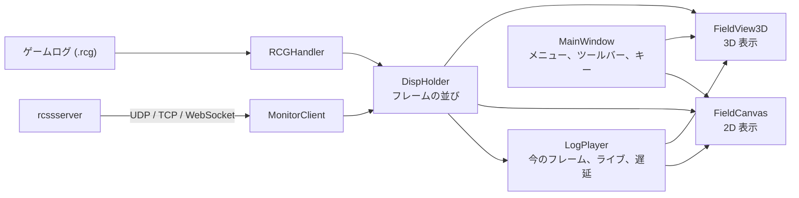
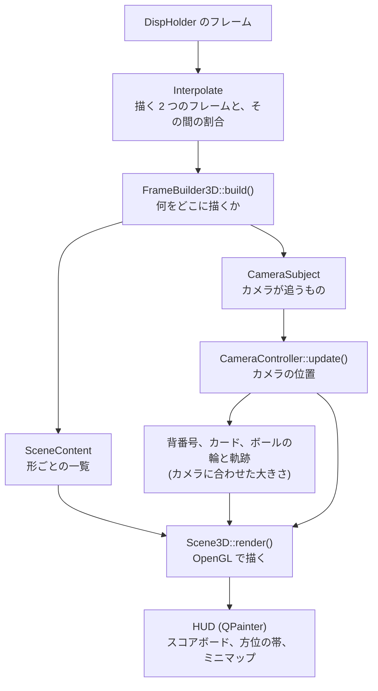
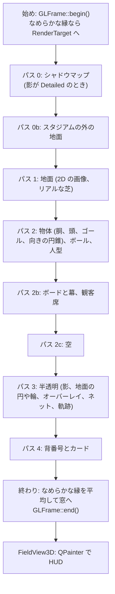

# 3D 表示の開発ガイド

| 項目 | 内容 |
|---|---|
| 対象 | rcssmonitor の 3D 表示を保守・改良する開発者とメンテナ (3D グラフィックスに明るくない人を含む) |
| 英語版 | [3d-view_en.md](3d-view_en.md) (内容は同じ) |
| 配布 | この文書は配布物 (tarball) に含めない (`docs/dev/` は `.gitattributes` で除く) |

この文書は、3D 表示のコードを読んで直せるようになるための解説である。利用者向けの説明は [docs/3d-view.md](../3d-view.md)、ビルドの手順は [docs/build.md](../build.md) にある。

## 目次

1. [この文書について](#1-この文書について)
2. [3D グラフィックスの基礎](#2-3d-グラフィックスの基礎)
3. [全体の構成](#3-全体の構成)
4. [座標系と単位](#4-座標系と単位)
5. [時間と補間](#5-時間と補間)
6. [ソースファイルとクラスの役割](#6-ソースファイルとクラスの役割)
7. [描画の流れとシェーダ](#7-描画の流れとシェーダ)
8. [人型と動き](#8-人型と動き)
9. [逆運動学 (IK)](#9-逆運動学-ik)
10. [人型パックとモデルの調整](#10-人型パックとモデルの調整)
11. [ボール](#11-ボール)
12. [スタジアムと背景](#12-スタジアムと背景)
13. [HUD と入力](#13-hud-と入力)
14. [性能](#14-性能)
15. [テスト](#15-テスト)
16. [よくある作業の手順](#16-よくある作業の手順)
17. [参考](#17-参考)

## 1. この文書について

### 1.1 読んでほしい人

- 3D 表示の不具合を直したり、機能を足したりする開発者。
- rcssmonitor を保守するメンテナ。2D の部分 (Qt のウィジェット、ログの読み込み、サーバとの通信) は知っているが、3D グラフィックス (OpenGL、シェーダ、骨格のアニメーション) には明るくない人を想定する。

### 1.2 この文書の書き方

- コードの場所は `ファイル名` と `クラス::関数()` で示す。行番号はすぐにずれるので使わない。
- ソースのコメントは、3D に明るくない人にもわかるように、考え方から書いてある。この文書は、その全体の地図と、コメントだけではわかりにくい流れを補う。細かい点は、まずソースのコメントを読んでほしい。
- 図は Mermaid で描いている (GitHub で表示できる)。

### 1.3 関連する文書

| 文書 | 内容 |
|---|---|
| [docs/plan/2026-11-11_3d-view.md](../plan/2026-11-11_3d-view.md) | 3D 表示の開発計画。決めたことの理由 (D1〜D16)、設計 (§5)、区切りごとの記録 (§14) |
| [docs/dev/FIGURE_ASSETS.md](FIGURE_ASSETS.md) | 人型の素材 (同梱のモデルとモーション) の作り方、変換、試験用のファイル |
| [docs/3d-view.md](../3d-view.md) | 利用者向けの 3D 表示の説明 (カメラ、キー、設定) |
| [docs/FIGURE_PACKS.md](../FIGURE_PACKS.md)、[docs/FIGURE_PACKS_MIXAMO.md](../FIGURE_PACKS_MIXAMO.md) | 利用者向けの人型パックの説明 |
| rcssmonitor-web (ブラウザ版) のソース | 3D 表示の参照実装 (three.js)。多くのクラスのコメントに、対応する web 版のファイルが書いてある |

## 2. 3D グラフィックスの基礎

この章は、この文書とソースに出てくる言葉の意味と、それが rcssmonitor のどこで使われているかを説明する。考え方をきちんと学ぶには、[LearnOpenGL](https://learnopengl.com/) (英語。日本語訳もある) の「Getting started」と「Lighting」、「Advanced OpenGL」の章がよい。

### 2.1 GPU と OpenGL

- 画面に 3D の絵を描くのは GPU である。CPU のプログラムは、形 (頂点の並び) と画像を GPU に送り、「この形をこの設定で描け」と頼む。
- その頼み方の決まりが **OpenGL** である。rcssmonitor は **OpenGL 3.3 core** を使う (計画書の D1)。古い OpenGL にあった「1 つずつ頂点を送る」書き方はなく、形を GPU のバッファに置き、シェーダ (後述) で描く。
- Qt は、OpenGL の関数の表 (`QOpenGLFunctions_3_3_Core`) と、OpenGL で描く窓 (`QOpenGLWindow`) を用意している。OpenGL は「今の文脈 (context)」に対して働くので、描く関数は文脈が今のもの (current) であるときにだけ呼べる。`QOpenGLWindow` は `initializeGL()` と `paintGL()` の間、文脈を今のものにしてくれる。
- rcssmonitor では、OpenGL の関数を呼ぶのは `src/view3d/gl/` の部品だけに限っている。ほかのコードは部品を使う。テスト `gl_isolation` がこれを確かめる (§15)。

### 2.2 頂点、メッシュ、三角形

- 3D の形は、**頂点** (点) をつないだ **三角形** の集まりで表す。これを **メッシュ** と呼ぶ。
- 頂点は、位置のほかに、**法線** (その点で面が向いている向き。光の当たり方に使う) や **テクスチャ座標** (画像のどこを貼るか、UV) を持つ。rcssmonitor の頂点は `Vertex3D` (`meshes_3d.h`) で、位置 3 つ、法線 3 つ、UV 2 つの 8 個の float である。
- 円柱 (選手の胴)、球 (頭とボール)、ゴールの柱などの基本の形は、`Meshes3D` (`meshes_3d.cpp`) がプログラムで作る。人の体は glTF や FBX のファイルから読む (§10)。

### 2.3 座標の変換と行列

1 つの頂点が画面のピクセルになるまでに、いくつかの座標を通る。

| 座標 | 意味 | rcssmonitor での行列 |
|---|---|---|
| モデル座標 | 形そのものの座標 (例: 半径 1、高さ 1 の円柱) | — |
| ワールド座標 | ピッチの上の位置 (メートル) | モデル行列 (`Instance3D::model`): 動かす、回す、大きさを変える |
| ビュー座標 | カメラから見た座標 (カメラが原点、-z の向きを見る) | ビュー行列 (`CameraPose::view()`) |
| クリップ座標 | 遠くのものを小さくし、見える範囲を -1〜1 の立方体に詰めたもの | 射影行列 (`CameraPose::projection()`) |
| 画面 | ピクセル | OpenGL がビューポートに合わせて変える |

- 変換は 4×4 の **行列** の掛け算で表す。Qt の `QMatrix4x4` を使う。`translate()`、`rotate()`、`scale()` は、呼んだ順と逆の順に形に効く (`instance_3d.h` のコメントに例がある)。
- シェーダには、射影行列とビュー行列を掛けた 1 つの行列 `uViewProj` を渡す。
- 回転は、角度のほかに **四元数** (`QQuaternion`) でも表す。骨格のアニメーションでは、回転を滑らかに混ぜられるので四元数を使う。

### 2.4 シェーダ

- **シェーダ** は、GPU が描くときに動かす小さなプログラムで、GLSL という言葉で書く。2 種類を組にして使う。
  - **頂点シェーダ** (`.vert`): 頂点ごとに動き、頂点をモデル座標から画面の座標へ動かす。法線や色を次へ渡す。
  - **フラグメントシェーダ** (`.frag`): 三角形が覆うピクセルごとに動き、そのピクセルの色を決める (光の計算、テクスチャ、霧、影)。
- シェーダへの入力は 2 つある。頂点ごとに違う **頂点属性** (位置、法線など。場所の番号は `gl/attributes.h`) と、描く全体で同じ **uniform** (カメラの行列、太陽の向きなど)。
- rcssmonitor のシェーダは `src/view3d/shaders/` にある 31 本 (頂点シェーダ 15、フラグメントシェーダ 16) で、Qt のリソース (`view3d_shaders.qrc`) として実行ファイルに埋め込む。`ShaderProgram::load()` (`gl/shader_program.h`) が頂点とフラグメントを組にし (同じ頂点シェーダを別のフラグメントシェーダと組むものや、`#define` で切り替えるものがある)、`Scene3D` は 18 のプログラムを使う。役割は §7 で説明する。

### 2.5 深度バッファ、カリング、半透明

- 手前のものが奥のものを隠すように、GPU はピクセルごとに「いちばん近いものまでの距離」(**深度**) を覚えている (**深度バッファ**)。新しく描くピクセルが、覚えている距離より遠ければ描かない (**深度テスト**)。
- 閉じた形の裏側の三角形は見えないので描かない (**カリング**)。
- 半透明のものは、奥のものの色と混ぜる (**ブレンド**)。正しく混ぜるには、不透明なものを先に描き、半透明なものを後から描く。
- これらの設定は、描くひとまとまり (**パス**) ごとに `RenderState` (`gl/render_state.h`) がまとめて決める。

### 2.6 テクスチャ

- **テクスチャ** は、GPU の上の画像で、シェーダが三角形に貼る。ピッチの芝と線 (2D の描画で作った画像)、背番号の文字 (`LabelAtlas`)、ボード、観客席、人型の服や肌に使う。
- 部品は `Texture2D` (`gl/texture_2d.h`)。シェーダは番号のついた「テクスチャユニット」を通して読む。

### 2.7 光と影

- 面の明るさは、面の向き (法線) と光の向きの角度で決まる (**ランバート反射**)。rcssmonitor の光は、太陽 (平行な光) と、空からの柔らかい光 (環境光) である。
- **影** は 2 通りある (設定 `shadows_3d`)。
  - Simple: 選手の足元に、柔らかい楕円を描くだけ (`blob` のシェーダ)。
  - Detailed: **シャドウマップ**。太陽から見た景色の深度だけをまず描き (`ShadowMap`、`depth` と `skinned_depth` のシェーダ)、地面を描くときに「この点は太陽から見て何かの陰か」を比べる (`shadow` のシェーダ)。
- スタジアムの外の地面は、遠いほど **霞** で地平線の色に近づけ、奥行きを出す (`Scenery3D`。選手などの物体にはかけない。§7.5)。

### 2.8 骨格とスキニング

- 人の体は、**骨** (ボーン、ジョイント) の木構造 (**骨格**、スケルトン) と、それに貼りついた皮 (メッシュ) でできている。骨を回すと、皮が付いて動く。
- 各頂点は、近くの最大 4 本の骨に **ウェイト** (どの骨にどれだけ付いて動くか) を持つ。頂点シェーダが、骨の行列をウェイトで混ぜて頂点を動かす。これを **スキニング** と呼ぶ (`SkinnedMesh`、`skinned` のシェーダ)。
- アニメーションのデータ (**クリップ**) は、時刻ごとの骨の回転と移動である。rcssmonitor は、クリップをそのまま再生するのではなく、ログから決めた速さと時刻で混ぜて姿勢を作る (§8)。
- 骨格は、モデルによって骨の数も名前も違う。rcssmonitor は、骨を「腰」「左ひざ」などの **役割** に対応づけて、違う骨格どうしで動きを移す (**リターゲット**。`HumanoidRig`)。

### 2.9 インスタンス描画

- 22 人の胴は、同じ円柱を違う場所、大きさ、色で描いたものである。形を 1 度だけ GPU に送り、フレームごとに「場所と色の一覧」だけを送って、1 回の命令でまとめて描く。これを **インスタンス描画** と呼ぶ (`InstancedMesh`、`SkinnedMesh`、`BillboardMesh`)。
- 描く命令の数は CPU の時間に効くので、まとめて描くことが速さにつながる。観客席の観客も同じ考えで描く (§12)。

### 2.10 なめらかな縁 (マルチサンプリング)

- 三角形の縁はピクセルの境目でギザギザになる。1 つのピクセルに色と深度の見本 (**サンプル**) を複数持たせ、最後に平均するとなめらかになる (**マルチサンプリング**、MSAA)。
- rcssmonitor は、サンプルを持つ別のフレームバッファ (`RenderTarget`) に描いてから、窓のフレームバッファへ平均して写す (設定 `antialias_3d`)。

## 3. 全体の構成

### 3.1 2D 表示との関係

3D 表示は、2D 表示と同じデータ (フレームの並び) を見て、別の窓に描く。ログの読み込み、サーバとの通信、再生の制御は 2D と共通である。

- `DispHolder` (`src/disp_holder.h`) は、受け取ったフレーム (`rcss::rcg::DispInfoT`: 1 サイクル分の選手とボールとプレイモード) の並びと、サーバのパラメータを持つ。
- `LogPlayer` (`src/log_player.h`) は、どのフレームを見せるか (再生、コマ送り、ライブ、遅延再生) を決める。
- `MainWindow` (`src/main_window.cpp`) は、2D の `FieldCanvas` と 3D の `FieldView3D` を `QStackedWidget` で切り替える。3D 表示は、初めて切り替えたときに作る (`MainWindow::toggleView3D()` のあたり)。作れない理由 (3D なしでビルドした、OpenGL 3.3 がない、offscreen のプラットフォーム) は `FieldView3D::unavailableReason()` が返す。
- 2D と 3D で共有する部品もある。オーバーレイの計算 (`src/overlay_math.h`)、選手の色と見た目 (`src/player_style.h`)、選手の選択 (`src/player_selection.h`)、審判のメニュー (`src/referee_menu.h`)、カメラと選手カメラの名前 (`src/camera_mode.h`、`src/player_camera_options.h`)。ピッチの地面の画像は、2D の `FieldPainter` が描いたものを使う (`GroundTexture`)。

### 3.2 3D 表示の中の流れ

`FieldView3D` が 1 フレームを描く流れ (`FieldView3D::paintGL()`) を図にする。

`FieldView3D::paintGL()` は、おおよそ次の順に動く。

1. 地面の画像を、色や設定が変わったときだけ描き直す (`GroundTexture::draw()` → `Scene3D::setGround()`)。
2. 描く 2 つのフレームと、その間の割合を決める (`Interpolate::position()`。ライブでは `Interpolate::LiveClock`、遅延再生では待ちの扱いもある。§5)。
3. 2D と同じく、ボールに近い選手を自動で選ぶ (設定による)。
4. チームの色、名前、ロゴが変わったら、ボード、幕、観客席の画像を作り直す (`Stadium3D`、`Stands3D`)。
5. 何をどこに描くかを決める (`FrameBuilder3D::build()` → `SceneContent`)。選手の姿勢、宙を飛ぶボール、オーバーレイもここで決まる。
6. 人型パックが変わったら、人の体を GPU に送る (`Scene3D::setFigureBody()`)。
7. カメラを、前のフレームからの時間だけ追わせる (`CameraController::update()`)。
8. 背番号とカード、ボールの輪と軌跡を、カメラと画面の大きさに合わせて足す。
9. OpenGL で描く (`Scene3D::render()`)。描く順は §7。
10. その上に QPainter で HUD を描く: スコアボード、チームのロゴ、オーバーレイの文字、方位の帯、ミニマップ、FPS (`Guides3D`、§13)。
11. 再生中、ライブで最新のフレームに追いつくまで、カメラが動いている間は、すぐ次を描く (`FieldView3D::drawNext()`)。止まっているときは描かない。

### 3.3 OpenGL を知らない部分と、知る部分

3D 表示のコードは、OpenGL を知らない部分と、知る部分に分けてある。テストで確かめやすくするためである (計画書 §5.1)。

| 部分 | OpenGL | 例 |
|---|---|---|
| 何を描くかを決める | 知らない | `FrameBuilder3D`、`SceneBuilder`、`SceneContent`、`Figures3D`、`Cameras3D`、`BallFlight`、`Stadium3D` |
| 描く | 知る | `Scene3D` と `src/view3d/gl/` の部品、`src/view3d/shaders/` |
| 窓と入力 | 知る (Qt が文脈を用意) | `FieldView3D` |

- 何を描くかを決める部分は、テストでログからフレームを作り、`SceneContent` の中身 (選手の位置、色、姿勢) を確かめられる (`frame_builder_3d`、`scene_builder` などのテスト)。
- 描く部分は、画面に出さないフレームバッファに描いて、ピクセルを確かめる (`scene_3d` のテスト)。

### 3.4 ビルド

- CMake の `ENABLE_3D` (既定 ON) と、Qt の OpenGL のモジュールがあるかで、3D 表示をビルドするかが決まる (トップの `CMakeLists.txt`)。ビルドするとき `config.h` に `HAVE_3D_VIEW` が定義される。3D 表示に関わる 2D 側のコード (メニュー、設定ダイアログ) は `#ifdef HAVE_3D_VIEW` で囲む。
- ソースは、静的ライブラリ `rcssmonitor_core` にまとめる (`src/CMakeLists.txt`)。実行ファイルとテストがこれをリンクする。3D のソースは `if(HAVE_3D_VIEW)` で足す。
- シェーダ (`src/view3d/shaders/view3d_shaders.qrc`) と同梱の人型パック (`resources/figures/view3d_figures.qrc`) は、Qt のリソースとして実行ファイルに埋め込む。
- 同梱のライブラリ: glTF を読む cgltf (`third_party/cgltf/`、ヘッダ 1 つ) と、FBX を読む ufbx (`third_party/ufbx/`)。
- Qt5 と Qt6 の両方でビルドする (計画書の D2)。Qt6 では `QOpenGLWindow` などが OpenGL と OpenGLWidgets のモジュールに分かれた。Qt5 では Widgets と Gui にある。違いは `CMakeLists.txt` の `QT_3D_VIEW_LIBRARIES` で吸収する。
- autotools のビルドは 3D 表示を含まない (計画書の D3)。

### 3.5 窓を QOpenGLWindow にした理由

`FieldView3D` は `QOpenGLWidget` ではなく、自分の窓 (`QOpenGLWindow`) を `QWidget::createWindowContainer()` でメインウィンドウに入れている。`QOpenGLWidget` は、描いた画像を Qt がもう一度メインウィンドウの画像へ写すので、4K の画面と内蔵 GPU では 1 秒に 31 フレームしか出なかった (窓なら 48。計画書 §14 の 9-6)。そのかわり、別の窓であることに由来する手当てがある。

- クリックがメニューを閉じない: 窓のクリックでは Qt が開いているメニューを閉じないので、`PopupCloser` が閉じる。
- キーボードの入力を取らない: キーはメインウィンドウのアクションが受ける。
- Wayland と XWayland の違い: 高解像度の画面では、XWayland を通すと遅くなる (利用者向けの [docs/3d-view.md](../3d-view.md) の「Running smoothly」)。

## 4. 座標系と単位

### 4.1 フィールドの座標 (ログと 2D)

- rcssserver のフィールドの座標は、x がピッチの長い向き (左のゴールが x = -52.5、右が +52.5)、y が短い向き (-34 〜 +34) で、単位はメートルである。2D 表示は y を下向きに描く (画面の上が y = -34)。
- 選手の体と首の向きは度で、x の正の向きが 0、y の正の向き (2D の画面で下) へ回ると正である。

### 4.2 3D のワールド座標

- 3D のワールド座標は、**x がフィールドの x、z がフィールドの y、y が上** で、単位はメートルである (web 版の `scene-math.ts` と同じ)。地面は y = 0 の面。
- 2D の画面の下側 (フィールドの y が正) が、3D では z が正の側になる。中継カメラは z が正の側 (手前のタッチラインの外) の高い所に置かれ、z が負の向きを見る。2D で見る向きとそろっている。
- フィールドの向き (度) を 3D の回転にするときは、y 軸 (上) の周りに回す。符号の扱いは `SceneBuilder` と `Figures3D` のコメントにある。迷ったら、テスト (`scene_builder` の向きの円錐の確かめ) を見るとよい。

### 4.3 そのほかの単位

| 量 | 単位 | 備考 |
|---|---|---|
| 長さ | メートル | ボールの半径は既定で 0.085 m (サーバの `ball_size`)。3D では設定 `ball_size_3d` で変えられる |
| 速さ | メートル / サイクル | サーバの単位。`BallFlight` の重力は m/サイクル² に直して使う |
| 時間 | サイクル | 1 サイクルはサーバの `simulator_step` (既定 100 ms) |
| 画面 | 論理ピクセル | 画面の倍率 (例: 1.5) を掛けたものが物理ピクセル。OpenGL のフレームバッファは物理ピクセル |
| 角度 | 度 | Qt の `rotate()` は度、三角関数はラジアン |

## 5. 時間と補間

### 5.1 フレームとサイクル

- `DispHolder` のフレームは、サーバの 1 サイクルにつき 1 つ (止まっている時間には stime で区別したフレームが並ぶ)。2D 表示は今のフレームをそのまま描く。
- 3D 表示は 1 秒に 60 回ほど描くので、2 つのフレームの **間** を描く。これがないと、選手もボールも 1 秒に 10 回飛び飛びに動いて見える。

### 5.2 フレームの間の補間

- `Interpolate` (`interpolate.h`) が、描く 2 つのフレーム (`Position::index`、`next`) と、その間の割合 (`alpha`、0〜1) を決め、間の show を作る (`Interpolate::show()`)。
- 位置は直線で混ぜ、体の向きは近い向きに回す (`lerpAngle()`)。プレイモードが変わったときと、1 サイクルで動けないほど跳んだもの (置き直し) は混ぜない。
- ログの再生中は、`LogPlayer::alpha()` (最後に進んでからの時間 / 1 フレームの時間) が割合になる。止めているときは 0。
- 大事な決まり: **姿勢やボールの高さは、フレームと割合だけから決める** (計画書 §5.2)。止めても、戻しても、跳んでも、同じフレームは同じに見える。そのため、ログを読んだときに表を作って持つもの (`GaitTable`、`BallSpin`、`BallFlight`) がある。

### 5.3 ライブの時計

- ライブでは、最新のフレームの 2 サイクル後ろを描く (`Interpolate::LIVE_DELAY`)。人型の動作は 2 フレーム先を見て振りかぶるので、その分を手元に置くためである (§8)。
- フレームが届く時刻はネットワークでぶれる。届くたびに描く時刻を合わせると、ボールがかくかくする。`Interpolate::LiveClock` は、シミュレーションの速さで進む時計を持ち、目標 (`Interpolate::liveTime()`) へ少しずつ寄せる。戻ることはなく、大きく離れたときだけ跳ぶ。

### 5.4 遅延再生

- 遅延再生 (Live Delay、計画書 §5.10) では、`LogPlayer` が、2D が見せるフレームを最新から決まった数だけ後ろに保つ (`LogPlayer::liveIndex()`)。3D は `Interpolate::liveTime()` に同じ遅延のフレーム数を渡し、同じ時刻を補間して描く。
- 接続した直後、フレームが遅延の分たまるまでは、最初のフレームを描く (`Interpolate::waitingLive()`)。この間、3D の時計は使わない (動かない目標を追い越して戻ることを繰り返すため)。
- 遅延再生では、描く時刻の先のフレームがあるので、宙を飛ぶボールを使える (§11)。

## 6. ソースファイルとクラスの役割

3D 表示のソースは `src/view3d/` にある (OpenGL の部品は `src/view3d/gl/`、シェーダは `src/view3d/shaders/`)。役割ごとに並べる。各ファイルの先頭とクラスのコメントに、詳しい説明がある。

### 6.1 窓と入力

| ファイル | クラス | 役割 |
|---|---|---|
| `field_view_3d` | `FieldView3D` | 3D 表示の窓 (`QOpenGLWindow`)。1 フレームを描く流れ (§3.2)、マウス、HUD、時間の計測 |
| `popup_closer` | `PopupCloser` | 3D の窓のクリックで、開いているメニューを閉じる (§3.5) |
| `fps_meter` | `FpsMeter` | 1 秒に描いたフレーム数と GPU の時間 (設定 `fps_3d`) |

### 6.2 時間

| ファイル | クラス | 役割 |
|---|---|---|
| `interpolate` | `Interpolate` (名前空間)、`Position`、`LiveClock` | 描く 2 つのフレームと割合、間の show、ライブの時計、遅延再生の時刻 (§5) |

### 6.3 何を描くかを決める (OpenGL を知らない)

| ファイル | クラス | 役割 |
|---|---|---|
| `frame_builder_3d` | `FrameBuilder3D`、`View3DState` | 1 フレームで描くものを決める。間の show、選手 (円柱か人型)、ボール、オーバーレイ、選手カメラの見え方、カメラが追うもの。テストもこれでフレームを作る |
| `scene_builder` | `SceneBuilder` | show から、ゴール、選手の胴と頭、向きの円錐、スタミナのバー、背番号、ボールを、形ごとの一覧に入れる |
| `scene_content` | `SceneContent` ほか | 1 フレームで描くものの入れ物 (形ごとのインスタンスの一覧、人型の姿勢、オーバーレイ、クリックの的) |
| `instance_3d` | `Instance3D`、`ColorVertex3D`、`Billboard3D` | 形の 1 つのコピー (モデル行列と色)、色つきの頂点、カメラを向く四角形 |
| `overlay_builder` | `OverlayBuilder` | 2D と同じオーバーレイ (線、点線、点、視野の範囲) を地面に描く頂点にする |
| `label_atlas` | `LabelAtlas` | 22 人の背番号を 1 枚の画像に並べる (1 つのテクスチャですむように) |
| `meshes_3d` | `Meshes3D`、`Vertex3D` | 基本の形 (円柱、球、円錐、四角形など) を作る |
| `guides_3d` | `Guides3D` | 方位の帯とミニマップ (QPainter で描く。§13) |

### 6.4 カメラ

| ファイル | クラス | 役割 |
|---|---|---|
| `camera_3d` | `CameraPose` | カメラの位置、見る点、画角と、ビュー行列、射影行列 |
| `cameras_3d` | `Cameras3D` (名前空間)、`CameraController` | カメラの種類ごとの置き方、ボールや選手を滑らかに追うこと、マウスでの操作、全体の視点 |
| `player_camera_3d` | `PlayerCamera3D`、`PlayerCameraState` | 選手カメラ (目の高さか肩の後ろ、向き、動き、画角) |
| `sight` | `PlayerSight`、`Perceptions` | 選手カメラの選手に、ほかの選手とボールがどう見えているか (サーバの見え方の決まり) |
| `picking` | `Picking`、`Ray` | クリックした点から、当たる選手か地面を探す (審判のメニュー) |
| (`src/camera_mode.h`) | `CameraMode`、`Viewpoint` | カメラと視点の名前 (設定、メニュー、コマンドライン) |
| (`src/player_camera_options.h`) | `PlayerCameraOptions` | 選手カメラの設定の値 |

### 6.5 描く (OpenGL を知る)

| ファイル | クラス | 役割 |
|---|---|---|
| `scene_3d` | `Scene3D` | GPU の資源を持ち、パスの順に描く (§7)。部品を組み合わせるだけで、OpenGL の呼び出しは部品の中 |
| `gl/shader_program` | `ShaderProgram` | シェーダの組を読み、uniform を設定する |
| `gl/attributes` | `GLAttribute` | 頂点属性の場所の番号 (シェーダと C++ で同じ番号を使う) |
| `gl/frame` | `GLFrame` | フレームの始まりと終わり (フレームバッファ、ビューポート、消去) |
| `gl/render_state` | `RenderState` | パスごとの描き方 (深度テスト、カリング、ブレンド) |
| `gl/render_target` | `RenderTarget` | なめらかな縁のためのサンプルを持つフレームバッファ |
| `gl/shadow_map` | `ShadowMap` | 太陽のシャドウマップ (深度だけのテクスチャ) |
| `gl/texture_2d` | `Texture2D` | GPU の上の画像 |
| `gl/instanced_mesh` | `InstancedMesh` | 形と、そのコピーをまとめて描く |
| `gl/skinned_mesh` | `SkinnedMesh` | 人型の体と、そのコピー (22 人) を、骨の行列で動かしてまとめて描く |
| `gl/billboard_mesh` | `BillboardMesh` | カメラを向く四角形 (背番号、カード) をまとめて描く |
| `gl/vertex_batch` | `VertexBatch` | フレームごとに形が変わる線や点や三角形 (オーバーレイ、視野の範囲) |
| `gl/gpu_timer` | `GpuTimer` | GPU が描くのにかかった時間を測る |
| `shaders/*.vert`、`*.frag` | — | シェーダ (頂点 15、フラグメント 16。§7) |

### 6.6 背景とスタジアム

| ファイル | クラス | 役割 |
|---|---|---|
| `ground_texture` | `GroundTexture` (名前空間) | 2D の `FieldPainter` でピッチの画像を描く |
| `grass_3d` | `Grass3D` | リアルな芝 (斑、すり減り。地面の画像に描く分と、シェーダで描く分) |
| `scenery_3d` | `Scenery3D` | 空、霞、スタジアムの外の地面 (シェーダと同じ計算をテストのために持つ) |
| `sun_3d` | `Sun3D` | 太陽の位置と、シャドウマップのカメラ |
| `stadium_3d` | `Stadium3D`、`TeamLook` | チームの色のボードと、チーム名とロゴの幕 |
| `stands_3d` | `Stands3D`、`Stand` | 観客席の形と、観客の画像 |

### 6.7 ボール

| ファイル | クラス | 役割 |
|---|---|---|
| `ball_3d` | `Ball3D`、`BallSpin` | ボールの模様と、道のりに合わせた転がり (ログから表を作って持つ) |
| `ball_aids_3d` | `BallAids3D`、`TrailPoint` | ボールの周りの輪と、軌跡 |
| `ball_flight_3d` | `BallFlight` | 宙を飛ぶボール (区間、浮かせる理由、上向きの初速、遅延ライブでの固定。§11) |

### 6.8 人型

| ファイル | クラス | 役割 |
|---|---|---|
| `figures_3d` | `Figures3D` | 人型パックのモデルとモーションを持ち、各選手の姿勢 (骨の行列) を作る。蹴る足の IK もここ (§9) |
| `humanoid` | `HumanoidRig`、`HumanoidPose` | 骨格の骨を役割に対応づけ、どの骨格でも使える姿勢に読み書きする (リターゲット) |
| `gait_table` | `GaitTable` | 各選手が各フレームまでに歩いた周期と速さ (ログから一度作って持つ) |
| `figure_actions` | `FigureActionLog` | 状態のビット (キック、タックル、キャッチ、ファウル) から動作の時刻を読む |
| `figure_pack` | `FigurePack`、`FigurePacks` | 人型パック (`figure.json`) を探して読む |
| `figure_looks` | `FigureLooks`、`FigureCast` | 選手ごとの体、髪型、肌と髪の色 |
| `figure_uniform` | `FigureUniform` | ユニフォームを塗る (服が終わる面、材質ごとの塗り方) |

### 6.9 モデルの読み込み

| ファイル | クラス | 役割 |
|---|---|---|
| `gltf_model` | `GltfModel` | glTF と VRM を cgltf で読み、骨格、皮、クリップを持つ (ほかの形式もこの形に読む) |
| `fbx_model` | `FbxModel` | FBX を ufbx で読んで `GltfModel` にする (Mixamo のファイルをそのまま) |
| `bvh_model` | `BvhModel` | BVH (モーションキャプチャ) を読んで `GltfModel` にする (骨格とクリップ 1 つ) |

### 6.10 2D 側で 3D に関わるファイル

| ファイル | 3D との関わり |
|---|---|
| `src/main_window.cpp` | 3D 表示の作成と切り替え、カメラと視点のメニューとツールバー、キー |
| `src/options.{h,cpp}` | 3D の設定 (グループ `View3D`)、コマンドライン |
| `src/config_dialog.cpp` | 設定ダイアログの 3D、Players & Ball、Camera のタブ |
| `src/log_player.{h,cpp}` | 補間の割合 (`alpha()`)、ライブ、遅延再生 |
| `src/overlay_math.h`、`src/player_style.h`、`src/player_selection.h`、`src/referee_menu.h` | 2D と 3D で共有する計算と見た目 |

## 7. 描画の流れとシェーダ

### 7.1 パスの順

`Scene3D::render()` は、1 フレームをいくつかの **パス** に分けて描く。パスは、描き方 (`RenderState`) を決め、シェーダのプログラムを選び (`ShaderProgram::bind()`)、uniform を設定し、形の一覧を描く (`InstancedMesh::draw()` など)。順番には意味がある。不透明なものを先に、半透明なものを後に、文字をいちばん最後に描く。

| パス | 描くもの | プログラム (頂点 / フラグメント) | 描き方 |
|---|---|---|---|
| 始め | フレームバッファを、地平線の色 (空を描くとき) か背景の色で消す (`GLFrame::begin()`) | — | — |
| 0 | シャドウマップ: 影を落とす物体 (胴、頭、ゴール、人型) を太陽から見た深度だけ。ボールと円錐は入れない | `depth`、人型は `skinned` + `depth`、髪など透ける部分は `skinned` + `skinned_depth` | opaque |
| 0b | 地面の画像の外の地面 (霞の中へ続く) | `outside` | opaque |
| 1 | 地面: 2D の画像 (テクスチャユニット 0)、リアルな芝の雑音 (ユニット 2) | `ground` | opaque |
| 2 | 物体: 円柱 (胴)、球 (頭)、円錐 (向き)、ゴール | `lit` | opaque |
| 2 (ボール) | ボールと模様 | `ball` | opaque |
| 2a | 人型 (骨の行列で姿勢をとった体、ユニフォーム) | `skinned`、テクスチャのある部分は `skinned` (`TEXTURED`) | opaque |
| 2b | ボードと幕 (表に画像、裏は無地) | `panel` | opaqueTwoSided |
| 2b' | 観客席 (カメラが中にあるものは描かない) | `stand` | opaque |
| 2c | 空のドーム。物体の後に、何もない所だけ | `sky` | sky |
| 3 | 半透明: 影 (Detailed はシャドウマップをユニット 1 で読む面、Simple は楕円)、地面の円と輪、ボールの輪、オーバーレイ (扇、線、点、点線)、ネット、ボールの軌跡。低い層から順に | `shadow` か `blob`、`flat`、`ring`、`colored` | translucent |
| 4 | 背番号とカード。カメラを向き、遠い順に | `billboard` | overlay |
| 終わり | なめらかな縁のサンプルを平均して窓のフレームバッファへ (`RenderTarget::resolve()`)。QPainter が描けるように OpenGL の状態を戻す (`GLFrame::end()`) | — | — |

この後、`FieldView3D::paintGL()` が QPainter で HUD を重ねる (§13)。

### 7.2 描き方 (RenderState)

`RenderState` は、深度テスト、深度の書き込み、裏面のカリング、ブレンドの 4 つを持つ。OpenGL は設定を変えるまで覚えているので、パスごとにすべてを設定し直す (前のパスの設定が残らないように)。

| 名前 | 深度テスト | 深度の書き込み | 裏面を描かない | ブレンド | 使う所 |
|---|---|---|---|---|---|
| `opaque()` | ○ | ○ | ○ | — | 地面、物体、ボール、人型、観客席 |
| `opaqueTwoSided()` | ○ | ○ | — | — | ボードと幕 (裏からも見える) |
| `sky()` | ○ | — | — | — | 空 (物体のない所だけに描き、深度を残さない) |
| `translucent()` | ○ | — | — | ○ | 影、地面の円、オーバーレイ、ネット。深度を書かないので、描く順が重なりを決める |
| `overlay()` | — | — | — | ○ | 背番号とカード (すべての上に) |
| `painter()` | — | ○ | — | — | QPainter に渡すときの状態 |

### 7.3 シェーダの一覧

シェーダのファイルは `src/view3d/shaders/` にあり、どれも先頭のコメントに役割と入力が書いてある。`ground.vert` と `ground.frag` には、頂点シェーダとフラグメントシェーダの働きそのものの説明がある。最初に読むとよい。

| プログラム | 描くもの | 主な入力と計算 | CPU 側の同じ計算 |
|---|---|---|---|
| `ground` | 地面 | 2D の画像を貼る。リアルな芝では、刈った縞をカメラの向きで明暗にし、近くだけ芝の葉の雑音を掛ける (`uRealistic`、`uCamera`、`uNoise`) | `Grass3D` |
| `outside` | 外の地面 | 色と、カメラからの距離による霞 (`uHazeFrom`〜`uHazeTo`) | `Scenery3D::haze()` |
| `sky` | 空 | 方向の高さで、地平線から天頂へ変わる色。地平線の下は外の地面の霞の色 | `Scenery3D::skyColor()` |
| `lit` | 物体 | 環境光 0.42 + 空からの光 0.22 × (0.5 + 0.5 × 法線の上向き) + 太陽 0.5 × max(法線・太陽, 0)。法線は「法線行列」(モデル行列の逆の転置) で回す | — |
| `ball` | ボール | `lit` と同じ光に、正二十面体の頂点にある 12 の五角形の模様。回る前の球の上の方向から、ピクセルごとに求める (近づいても縁がぼけない) | `Ball3D::patternAt()` |
| `skinned` | 人型 | 骨の行列で頂点を動かし (§7.6)、`lit` と同じ光。塗り方 (`uPaint`: 材質の色、チームの色、ユニフォーム、髪、肌) と、服が終わる面 (`uCuts`)。`TEXTURED` の版はテクスチャと透け (髪の板) を扱う | `FigureUniform` |
| `depth` | シャドウマップの深度 | 太陽のカメラ (`Sun3D::shadowViewProj()`) で位置だけ。色は書かない | — |
| `skinned_depth` | 人型の透ける部分の深度 | テクスチャの透明な所は影を落とさない | — |
| `shadow` | 影の面 (地面のすぐ上) | シャドウマップを比べて読み (`sampler2DShadow`)、少しずらした点の平均で縁をやわらげる。地図の丸めに負けないよう約 7 cm の余裕 | — |
| `blob` | Simple の影 | 単位円を太陽と逆へのびる楕円にし、中心が濃く縁で消える | `Sun3D::blobShadow()` |
| `flat` | 平たい色 | 地面の円、輪、ボールの影、ネット。色の alpha で半透明 | — |
| `ring` | ボールの輪 | 正方形の上に、線の幅を保った輪とうすい塗り (1 ピクセルでなめらかに) | — |
| `colored` | オーバーレイ | 頂点ごとの色。点線は線に沿った距離 (`DISTANCE`) で切る | — |
| `panel` | ボードと幕 | 表に画像、裏は無地 (`gl_FrontFacing` で表裏を見分ける) | — |
| `stand` | 観客席 | 観客の画像を、`lit` と同じ光で | — |
| `billboard` | 背番号とカード | ビュー行列の行 (カメラの右と上) に沿って四角形を広げ、カメラを向かせる。画像を色で染める | — |

### 7.4 頂点属性とインスタンス

- 頂点属性の場所の番号は `gl/attributes.h` の `GLAttribute` にまとめてある (位置 0、法線 1、UV 2、モデル行列 3〜6 (mat4 は 4 つ使う)、色 7、点線の距離 8、骨の番号 9、ウェイト 10 など)。`ShaderProgram` は、シェーダの先頭に `#version 330 core` と `#define A_POSITION 0` などを足してからコンパイルする。シェーダは `layout( location = A_POSITION )` と書く。
- 属性には、頂点ごとのもの (形に共通) と、インスタンスごとのもの (コピーごとの場所と色) がある。インスタンスごとの属性は「divisor 1」で設定し、OpenGL はインスタンスが変わるたびに次の値へ進む (`InstancedMesh::create()`)。
- `BillboardMesh` はモデル行列のかわりに自分の属性を同じ場所に置く。`VertexBatch` はインスタンスを使わず、頂点ごとに色を持つ。

### 7.5 光、霞、影

- 光は `lit.frag` の 3 つの和である (表の `lit`)。値は目で見て合わせた。人型 (`skinned.frag`) と観客席 (`stand.frag`) も同じ計算を使う。光を変えるときは 3 つをそろえる。
- 太陽の向きは `Sun3D` にある (遠い側のタッチラインの向こう、左、44° の高さ)。手前から見ると、影は右手前へ落ちる。
- 霞は、スタジアムの外の地面 (`outside`) と空 (`sky`) にだけかかる。選手や観客席にはかからない。
- 影が Detailed のとき: パス 0 でシャドウマップを描き、パス 3 で影の面がそれを読む。影の面は地面のすぐ上 (`Sun3D::SHADOW_PLANE_Y`) の半透明の黒で、影の濃さは `Sun3D::SHADOW_OPACITY`。シャドウマップの覆う範囲と高さは `Sun3D` の定数にある (両手を上げた背の高い人型まで入るように 4 m)。
- 影が Simple のとき: パス 3 で選手ごとに楕円を描くだけで、シャドウマップは描かない。

### 7.6 GPU でのスキニング

- 人型の体の頂点は、最大 4 本の骨の番号とウェイトを持つ (`SkinVertex`、`GltfModel`)。各選手の姿勢は、骨ごとの **スキン行列** (骨を休みの姿勢から今の姿勢へ動かす行列) の並びで、`Figures3D::pose()` が作る。
- 22 人 × 数十本の骨の行列は uniform に入りきらないので、テクスチャに入れる (`uJoints`。1 行が 1 人、1 本の骨が 4 テクセル (行列の 4 列))。頂点シェーダは `gl_InstanceID` で自分の行を、骨の番号で列を読む (`skinned.vert`)。
- テクスチャや透けのない部分は軽い版、ある部分 (髪の板、まつげなど) は `TEXTURED` の版で描く。シャドウマップでも、透ける部分は `skinned_depth.frag` が透明な所を捨てる。

### 7.7 シェーダを直すとき

- シェーダは Qt のリソースとして実行ファイルに埋め込まれる。直したらビルドし直す。新しいファイルは `view3d_shaders.qrc` に足す。
- コンパイルやリンクに失敗すると、`(ShaderProgram) ...` で始まるエラーが標準エラーに出て、`Scene3D::initialize()` が失敗し、3D 表示は使えなくなる。GLSL は 3.30 core の書き方で書く (`gl_FragColor` ではなく `out` の変数)。
- CPU 側に同じ計算を持つシェーダがある (表の右の列)。テストは CPU 側の計算で色や形を確かめるので、シェーダを直したら CPU 側も同じに直す。
- 描いた結果は、テスト `scene_3d` が画面に出さないフレームバッファで確かめる (§15)。
- 時間は `RCSSMONITOR_3D_TIMING` と FPS の表示で測る (§14)。描いたフレームを取り込んで 1 つずつ調べたいときは、RenderDoc などの外部の道具が使える。
- OpenGL の関数と定数は `src/view3d/gl/` の外で使わない (テスト `gl_isolation`)。新しい描き方が要るときは、部品か部品の関数を足す。

### 7.8 新しいものを描く手順

`Scene3D` のクラスのコメントにある手順を、具体的に書く。

1. 形を `Meshes3D` に足す (単位の大きさで、原点に)。
2. `Scene3D` にその形の `InstancedMesh` を持たせ、`initialize()` で作り、`release()` で消す。
3. `SceneContent` にインスタンスの一覧を足す。
4. `SceneBuilder` (か `FrameBuilder3D`) で、一覧にインスタンス (モデル行列と色) を入れる。
5. `Scene3D::render()` の、合うシェーダと描き方のパスに `draw()` を足す。新しいシェーダが要るなら、`src/view3d/shaders/` にファイルを作って `.qrc` に足し、`initialize()` で `load()` する。
6. テストを足す: 一覧の中身は `scene_builder` か `frame_builder_3d`、描いたピクセルは `scene_3d`。

## 8. 人型と動き

(10-3c で書く)

## 9. 逆運動学 (IK)

(10-3c で書く)

## 10. 人型パックとモデルの調整

(10-3c で書く)

## 11. ボール

(10-3d で書く)

## 12. スタジアムと背景

(10-3d で書く)

## 13. HUD と入力

(10-3d で書く)

## 14. 性能

(10-3d で書く)

## 15. テスト

(10-3d で書く)

## 16. よくある作業の手順

(10-3d で書く)

## 17. 参考

(10-3d で書く)
