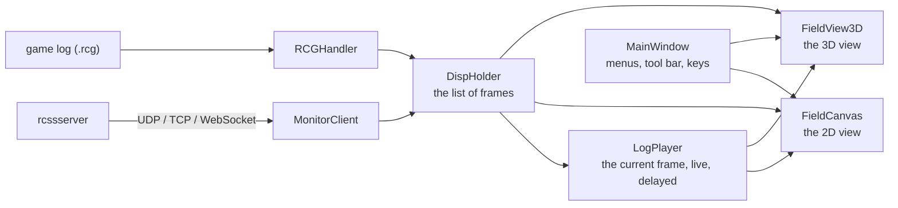
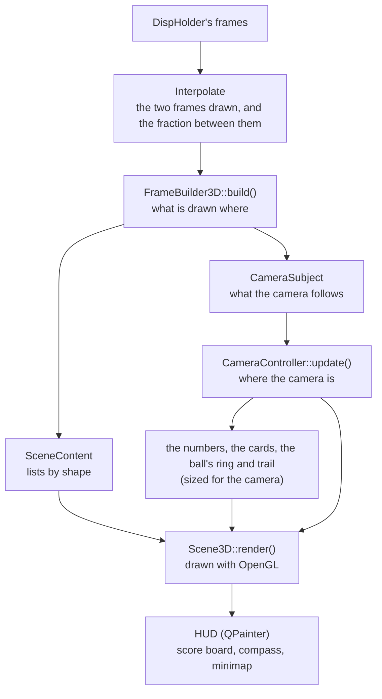
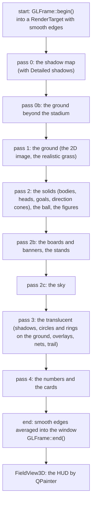

# The 3D view: a guide for developers

| Item | Content |
|---|---|
| For | Developers and maintainers who maintain and improve rcssmonitor's 3D view (including those not versed in 3D graphics) |
| Japanese version | [3d-view.md](3d-view.md) (same content) |
| Distribution | This document is not in the distribution (tarball): `docs/dev/` is left out by `.gitattributes` |

This document explains the code of the 3D view, so that you can read and change it. The description for users is [docs/3d-view.md](../3d-view.md), and the build is described in [docs/build.md](../build.md).

## Contents

1. [About this document](#1-about-this-document)
2. [The basics of 3D graphics](#2-the-basics-of-3d-graphics)
3. [The structure](#3-the-structure)
4. [Coordinates and units](#4-coordinates-and-units)
5. [Time and interpolation](#5-time-and-interpolation)
6. [The source files and classes](#6-the-source-files-and-classes)
7. [Drawing and the shaders](#7-drawing-and-the-shaders)
8. [The human figures and their motion](#8-the-human-figures-and-their-motion)
9. [Inverse kinematics (IK)](#9-inverse-kinematics-ik)
10. [Figure packs and adjusting the models](#10-figure-packs-and-adjusting-the-models)
11. [The ball](#11-the-ball)
12. [The stadium and the scenery](#12-the-stadium-and-the-scenery)
13. [The HUD and input](#13-the-hud-and-input)
14. [Performance](#14-performance)
15. [Tests](#15-tests)
16. [Common tasks](#16-common-tasks)
17. [References](#17-references)

## 1. About this document

### 1.1 Who it is for

- Developers who fix the 3D view's bugs or add to it.
- Maintainers of rcssmonitor. It assumes you know the 2D parts (Qt's widgets, reading game logs, talking to the server), but not 3D graphics (OpenGL, shaders, skeletal animation).

### 1.2 How it is written

- Places in the code are given as `file name` and `Class::function()`. Line numbers are not used; they soon change.
- The comments in the sources are written from the ideas, so that those not versed in 3D can follow them. This document gives the map of the whole and the flows that the comments alone do not make clear. For the details, read the comments in the sources first.
- The diagrams are in Mermaid (GitHub shows them).

### 1.3 Related documents

| Document | Content |
|---|---|
| [docs/plan/2026-11-11_3d-view_en.md](../plan/2026-11-11_3d-view_en.md) | The plan of the 3D view: the reasons of the decisions (D1 to D16), the design (§5), the record of each step (§14) |
| [docs/dev/FIGURE_ASSETS.md](FIGURE_ASSETS.md) | How the figures' material (the bundled models and motions) is made and converted, and the test files |
| [docs/3d-view.md](../3d-view.md) | The 3D view for users (cameras, keys, settings) |
| [docs/FIGURE_PACKS.md](../FIGURE_PACKS.md), [docs/FIGURE_PACKS_MIXAMO.md](../FIGURE_PACKS_MIXAMO.md) | Figure packs for users |
| The sources of rcssmonitor-web (the browser version) | The reference implementation of the 3D view (three.js). Many classes' comments name the web version's file they follow |

## 2. The basics of 3D graphics

This chapter tells what the words in this document and in the sources mean, and where rcssmonitor uses them. To learn the ideas properly, the chapters "Getting started", "Lighting" and "Advanced OpenGL" of [LearnOpenGL](https://learnopengl.com/) are good.

### 2.1 The GPU and OpenGL

- The GPU draws the 3D pictures on the screen. A program on the CPU sends shapes (lists of vertices) and images to the GPU, and asks it to draw a shape with some settings.
- **OpenGL** is the rules of asking. rcssmonitor uses **OpenGL 3.3 core** (D1 of the plan). The old way of OpenGL, sending vertices one by one, is not there: shapes are put in the GPU's buffers, and drawn by shaders (below).
- Qt provides the table of OpenGL's functions (`QOpenGLFunctions_3_3_Core`) and a window drawn with OpenGL (`QOpenGLWindow`). OpenGL works on the "current context", so the drawing functions can be called only while the context is current. `QOpenGLWindow` makes it current during `initializeGL()` and `paintGL()`.
- In rcssmonitor, only the parts in `src/view3d/gl/` call OpenGL's functions; the rest of the code uses the parts. The test `gl_isolation` checks this (§15).

### 2.2 Vertices, meshes and triangles

- A 3D shape is a set of **triangles** joining **vertices** (points), a **mesh**.
- Besides its position, a vertex has a **normal** (the direction the surface faces there, for how it is lit) and **texture coordinates** (where on an image it is, the UV). rcssmonitor's vertex is `Vertex3D` (`meshes_3d.h`): 8 floats, 3 of the position, 3 of the normal and 2 of the UV.
- The basic shapes, a cylinder (a player's body), a sphere (the head and the ball), the goal posts and so on, are made by the program in `Meshes3D` (`meshes_3d.cpp`). The human bodies are read from glTF or FBX files (§10).

### 2.3 Transforming the coordinates, and matrices

A vertex passes through several coordinates until it becomes pixels on the screen.

| Coordinates | What they are | The matrix in rcssmonitor |
|---|---|---|
| Model | The shape's own (e.g. a cylinder of radius 1 and height 1) | — |
| World | Where on the pitch (meters) | The model matrix (`Instance3D::model`): moves, turns and scales |
| View | As the camera sees them (the camera at the origin, looking down -z) | The view matrix (`CameraPose::view()`) |
| Clip | Far things made smaller, and what is seen squeezed into a cube from -1 to 1 | The projection matrix (`CameraPose::projection()`) |
| Screen | Pixels | OpenGL maps them to the viewport |

- Each transformation is a product of 4x4 **matrices**, with Qt's `QMatrix4x4`. `translate()`, `rotate()` and `scale()` apply to the shape in the reverse order of the calls (`instance_3d.h` has an example).
- The shaders get one matrix, `uViewProj`, the projection matrix times the view matrix.
- Rotations are given as **quaternions** (`QQuaternion`) as well as angles. Skeletal animation uses quaternions, which blend smoothly.

### 2.4 Shaders

- A **shader** is a small program that the GPU runs while drawing, written in a language called GLSL. Two kinds are used as a pair:
  - The **vertex shader** (`.vert`) runs for every vertex: it moves the vertex from the model's coordinates to the screen's, and passes the normal, the color and so on on.
  - The **fragment shader** (`.frag`) runs for every pixel a triangle covers, and decides its color (lighting, textures, fog, shadows).
- A shader has two kinds of inputs: **vertex attributes**, which differ from vertex to vertex (position, normal and so on; their location numbers in `gl/attributes.h`), and **uniforms**, the same for the whole drawing (the camera's matrix, the sun's direction and so on).
- rcssmonitor's shaders are the 31 files in `src/view3d/shaders/` (15 vertex shaders, 16 fragment shaders), embedded in the program as Qt resources (`view3d_shaders.qrc`). `ShaderProgram::load()` (`gl/shader_program.h`) pairs a vertex shader with a fragment shader (some vertex shaders go with several fragment shaders, and some programs switch parts by a `#define`), and `Scene3D` uses 18 programs. §7 tells their roles.

### 2.5 The depth buffer, culling and translucency

- So that near things hide far ones, the GPU keeps for every pixel how far the nearest thing is (the **depth**, in the **depth buffer**). A new pixel farther than that is not drawn (the **depth test**).
- The triangles at the back of a closed shape cannot be seen, so they are not drawn (**culling**).
- Translucent things are mixed with the colors behind them (**blending**). To mix them right, the opaque things are drawn first, and the translucent ones after.
- `RenderState` (`gl/render_state.h`) sets these for each group of drawing (a **pass**).

### 2.6 Textures

- A **texture** is an image on the GPU, which a shader paints onto triangles: the grass and the lines of the pitch (an image drawn by the 2D drawing), the numbers on the players (`LabelAtlas`), the boards, the stands, and the clothes and skin of the human figures.
- The part is `Texture2D` (`gl/texture_2d.h`). A shader reads it through a numbered "texture unit".

### 2.7 Light and shadows

- How bright a surface is depends on the angle between its direction (the normal) and the light's (**Lambertian reflection**). rcssmonitor's lights are the sun (parallel light) and the soft light from the sky (ambient light).
- **Shadows** come in two ways (the option `shadows_3d`):
  - Simple: a soft ellipse under each player only (the `blob` shaders).
  - Detailed: a **shadow map**. The scene's depths as the sun sees them are drawn first (`ShadowMap`, the `depth` and `skinned_depth` shaders), and drawing the ground compares whether a point is in the shadow of something as seen from the sun (the `shadow` shaders).
- The ground beyond the stadium is brought nearer the horizon's color by **haze** the farther it is, which gives depth (`Scenery3D`; not the players and other solids; §7.5).

### 2.8 Skeletons and skinning

- A human body is a tree of **bones** (joints), the **skeleton**, and a skin (a mesh) on it. When the bones turn, the skin moves with them.
- Each vertex has **weights** for up to 4 nearby bones (how much it moves with each). The vertex shader moves the vertex by the bones' matrices mixed by the weights. This is **skinning** (`SkinnedMesh`, the `skinned` shaders).
- The data of an animation (a **clip**) is the bones' rotations and moves at each time. rcssmonitor does not play the clips as they are: it blends them at the speed and time decided from the log, to make a pose (§8).
- Skeletons differ in the number and the names of their bones. rcssmonitor maps the bones to **roles**, such as "hips" and "left knee", and moves a motion from one skeleton to another (**retargeting**; `HumanoidRig`).

### 2.9 Instanced drawing

- The 22 players' bodies are the same cylinder drawn at different places, sizes and colors. The shape is sent to the GPU once, and in every frame only the list of places and colors is sent and drawn with one command. This is **instanced drawing** (`InstancedMesh`, `SkinnedMesh`, `BillboardMesh`).
- The number of drawing commands costs the CPU's time, so drawing together makes it fast. The fans in the stands are drawn by the same idea (§12).

### 2.10 Smooth edges (multisampling)

- The edges of triangles are jagged at the borders of pixels. Keeping several **samples** of color and depth in each pixel, and averaging them at the end, makes them smooth (**multisampling**, MSAA).
- rcssmonitor draws into another framebuffer with samples (`RenderTarget`), then averages it into the window's framebuffer (the option `antialias_3d`).

## 3. The structure

### 3.1 Its relation to the 2D view

The 3D view looks at the same data (the list of frames) as the 2D view, and draws it in another window. Reading game logs, talking to the server and controlling the replay are shared with 2D.

- `DispHolder` (`src/disp_holder.h`) holds the list of the frames received (`rcss::rcg::DispInfoT`: the players, the ball and the play mode of a cycle) and the server's parameters.
- `LogPlayer` (`src/log_player.h`) decides which frame is shown (playing, stepping, live, delayed).
- `MainWindow` (`src/main_window.cpp`) switches between the 2D `FieldCanvas` and the 3D `FieldView3D` in a `QStackedWidget`. The 3D view is made the first time it is switched to (around `MainWindow::toggleView3D()`). The reason it cannot be made (built without the 3D view, no OpenGL 3.3, the offscreen platform) comes from `FieldView3D::unavailableReason()`.
- Some parts are shared by 2D and 3D: the computations of the overlays (`src/overlay_math.h`), the players' colors and looks (`src/player_style.h`), the player selection (`src/player_selection.h`), the referee's menu (`src/referee_menu.h`), and the names of the cameras and of the player camera's options (`src/camera_mode.h`, `src/player_camera_options.h`). The image of the pitch's ground is drawn by the 2D `FieldPainter` (`GroundTexture`).

### 3.2 The flow inside the 3D view

How `FieldView3D` draws a frame (`FieldView3D::paintGL()`):

`FieldView3D::paintGL()` goes roughly in this order:

1. The image of the ground is drawn again only when its colors or options changed (`GroundTexture::draw()` -> `Scene3D::setGround()`).
2. The two frames drawn, and the fraction between them, are decided (`Interpolate::position()`; live, `Interpolate::LiveClock`, and in the delayed view the wait; §5).
3. As in 2D, the player nearest the ball is selected automatically (by the options).
4. When the teams' colors, names or logos changed, the images of the boards, the banners and the stands are made again (`Stadium3D`, `Stands3D`).
5. What is drawn where is decided (`FrameBuilder3D::build()` -> `SceneContent`), with the players' poses, the flying ball and the overlays.
6. When the figure pack changed, the human bodies are sent to the GPU (`Scene3D::setFigureBody()`).
7. The camera follows for the time since the last frame (`CameraController::update()`).
8. The numbers and the cards, and the ball's ring and trail, are added, sized for the camera and the screen.
9. It is drawn with OpenGL (`Scene3D::render()`); §7 tells the order.
10. QPainter draws the HUD over it: the score board, the team logos, the overlays' texts, the compass, the minimap, the FPS (`Guides3D`; §13).
11. While a log plays, live until the newest frame is reached, and while the camera moves, the next frame is drawn at once (`FieldView3D::drawNext()`). Still, nothing is drawn.

### 3.3 The parts that do not know OpenGL, and those that do

The code of the 3D view is split into parts that do not know OpenGL and parts that do, so that the tests can check them (§5.1 of the plan).

| Part | OpenGL | Examples |
|---|---|---|
| Deciding what is drawn | Not known | `FrameBuilder3D`, `SceneBuilder`, `SceneContent`, `Figures3D`, `Cameras3D`, `BallFlight`, `Stadium3D` |
| Drawing | Known | `Scene3D` and the parts in `src/view3d/gl/`, `src/view3d/shaders/` |
| The window and input | Known (Qt provides the context) | `FieldView3D` |

- The deciding parts are tested by making frames from a log and checking what is in `SceneContent` (the players' places, colors, poses): the tests `frame_builder_3d`, `scene_builder` and others.
- The drawing parts are tested by drawing into a framebuffer that is not shown and checking its pixels (the test `scene_3d`).

### 3.4 The build

- CMake's `ENABLE_3D` (ON by default) and whether Qt's OpenGL modules are found decide whether the 3D view is built (the top `CMakeLists.txt`). When it is, `HAVE_3D_VIEW` is defined in `config.h`. The code of the 2D side that concerns the 3D view (the menus, the settings dialog) is in `#ifdef HAVE_3D_VIEW`.
- The sources are gathered into a static library, `rcssmonitor_core` (`src/CMakeLists.txt`), which the program and the tests link. The 3D sources are added in `if(HAVE_3D_VIEW)`.
- The shaders (`src/view3d/shaders/view3d_shaders.qrc`) and the bundled figure packs (`resources/figures/view3d_figures.qrc`) are embedded in the program as Qt resources.
- The bundled libraries: cgltf, which reads glTF (`third_party/cgltf/`, one header), and ufbx, which reads FBX (`third_party/ufbx/`).
- It is built with both Qt5 and Qt6 (D2 of the plan). In Qt6, `QOpenGLWindow` and others moved into the OpenGL and OpenGLWidgets modules; in Qt5 they are in Widgets and Gui. `QT_3D_VIEW_LIBRARIES` in `CMakeLists.txt` hides the difference.
- The autotools build does not include the 3D view (D3 of the plan).

### 3.5 Why the window is a QOpenGLWindow

`FieldView3D` is not a `QOpenGLWidget` but a window of its own (`QOpenGLWindow`), put into the main window by `QWidget::createWindowContainer()`. With a `QOpenGLWidget`, Qt copies the drawn image once more into the main window's, and a 4K screen with an integrated GPU got only 31 frames a second (48 with the window; 9-6 in §14 of the plan). In exchange, being another window needs some care:

- A click does not close a menu: Qt does not close an open menu on a click in a window of its own, so `PopupCloser` closes it.
- It takes no keyboard input: the keys go to the main window's actions.
- Wayland and XWayland: at high resolutions, going through XWayland is slow ("Running smoothly" in [docs/3d-view.md](../3d-view.md) for users).

## 4. Coordinates and units

### 4.1 The field's coordinates (the log and 2D)

- rcssserver's field has x along the pitch (the left goal at x = -52.5, the right at +52.5) and y across it (-34 to +34), in meters. The 2D view draws y downward (the top of the screen is y = -34).
- The directions of a player's body and neck are in degrees: 0 along positive x, positive turning toward positive y (down on the 2D screen).

### 4.2 The 3D world's coordinates

- The 3D world has **x along the field's x, z along the field's y, and y up**, in meters (as the web version's `scene-math.ts`). The ground is the plane y = 0.
- The bottom of the 2D screen (positive y of the field) is the side of positive z in 3D. The broadcast camera is high on the side of positive z (beyond the near touch line), looking toward negative z: the same way as the 2D view is seen.
- A field direction (degrees) becomes a 3D rotation about the y axis (up). The comments of `SceneBuilder` and `Figures3D` tell the signs. When in doubt, see the tests (the direction cones checked in `scene_builder`).

### 4.3 Other units

| Quantity | Unit | Notes |
|---|---|---|
| Length | Meters | The ball's radius is 0.085 m by default (the server's `ball_size`); in 3D it can be changed by the option `ball_size_3d` |
| Speed | Meters per cycle | The server's unit. `BallFlight` turns gravity into m/cycle² |
| Time | Cycles | A cycle is the server's `simulator_step` (100 ms by default) |
| Screen | Logical pixels | Times the screen's scale (e.g. 1.5) are physical pixels. OpenGL's framebuffers are in physical pixels |
| Angles | Degrees | Qt's `rotate()` takes degrees; the trigonometric functions radians |

## 5. Time and interpolation

### 5.1 Frames and cycles

- `DispHolder` has one frame for each cycle of the server (in a stopped time, frames told apart by the stopped time follow). The 2D view draws the current frame as it is.
- The 3D view draws about 60 times a second, so it draws the positions **between** two frames. Without that, the players and the ball would jump 10 times a second.

### 5.2 Interpolating between frames

- `Interpolate` (`interpolate.h`) decides the two frames drawn (`Position::index`, `next`) and the fraction between them (`alpha`, 0 to 1), and makes the show between them (`Interpolate::show()`).
- Positions are mixed linearly, and the body direction turns the short way round (`lerpAngle()`). A play mode change, and an object that jumped farther than it can move in a cycle (a placement), are not mixed.
- While a log plays, `LogPlayer::alpha()` (the time since the last step over the time of a frame) is the fraction; stopped, it is 0.
- An important rule: **the poses and the ball's height are decided from the frames and the fraction only** (§5.2 of the plan). A frame looks the same however it is reached: paused, stepped back, jumped to. So some tables are made from the log when it is read, and kept (`GaitTable`, `BallSpin`, `BallFlight`).

### 5.3 The live clock

- Live, the view is drawn two cycles behind the newest frame (`Interpolate::LIVE_DELAY`). The figures wind up for an action looking two frames ahead, which then are at hand (§8).
- The times the frames come vary with the network. Following each coming would make the ball jerk. `Interpolate::LiveClock` keeps a clock going at the simulation's speed, brought gently toward the target (`Interpolate::liveTime()`). It never goes back, and jumps only when far from it.

### 5.4 The delayed live view

- In the delayed live view (Live Delay, §5.10 of the plan), `LogPlayer` keeps the frame the 2D view shows a fixed number of frames behind the newest (`LogPlayer::liveIndex()`). The 3D view passes the same delay in frames to `Interpolate::liveTime()`, and draws the same time interpolated.
- Right after connecting, until the delay's frames have come, the first frame is drawn (`Interpolate::waitingLive()`). Meanwhile the 3D clock is not used (it would run past a target that does not go on, and jump back, again and again).
- In the delayed view, the frames ahead of the time drawn are at hand, so the ball can fly (§11).

## 6. The source files and classes

The 3D view's sources are in `src/view3d/` (the OpenGL parts in `src/view3d/gl/`, the shaders in `src/view3d/shaders/`), here by role. The comments at the top of each file and of its classes tell the details.

### 6.1 The window and input

| File | Class | Role |
|---|---|---|
| `field_view_3d` | `FieldView3D` | The window of the 3D view (`QOpenGLWindow`): drawing a frame (§3.2), the mouse, the HUD, measuring the time |
| `popup_closer` | `PopupCloser` | Closes an open menu on a click in the 3D window (§3.5) |
| `fps_meter` | `FpsMeter` | The frames drawn a second and the GPU's time (the option `fps_3d`) |

### 6.2 Time

| File | Class | Role |
|---|---|---|
| `interpolate` | `Interpolate` (namespace), `Position`, `LiveClock` | The two frames drawn and the fraction, the show between them, the live clock, the time of the delayed view (§5) |

### 6.3 Deciding what is drawn (not knowing OpenGL)

| File | Class | Role |
|---|---|---|
| `frame_builder_3d` | `FrameBuilder3D`, `View3DState` | Decides what a frame draws: the show between the frames, the players (cylinders or figures), the ball, the overlays, what the player camera's player perceives, what the cameras follow. The tests make frames with it too |
| `scene_builder` | `SceneBuilder` | From a show, puts the goals, the players' bodies and heads, the direction cones, the stamina bars, the numbers and the ball in the lists by shape |
| `scene_content` | `SceneContent` and others | What a frame draws (the lists of instances by shape, the figures' poses, the overlays, the targets of clicks) |
| `instance_3d` | `Instance3D`, `ColorVertex3D`, `Billboard3D` | A copy of a shape (a model matrix and a color), a vertex with its color, a rectangle facing the camera |
| `overlay_builder` | `OverlayBuilder` | Turns the overlays of 2D (lines, dotted lines, dots, view areas) into vertices on the ground |
| `label_atlas` | `LabelAtlas` | The 22 players' numbers side by side in one image (so that one texture serves them) |
| `meshes_3d` | `Meshes3D`, `Vertex3D` | Makes the basic shapes (cylinder, sphere, cone, quad and so on) |
| `guides_3d` | `Guides3D` | The compass and the minimap (drawn by QPainter; §13) |

### 6.4 Cameras

| File | Class | Role |
|---|---|---|
| `camera_3d` | `CameraPose` | Where a camera is, where it looks, its field of view, and the view and projection matrices |
| `cameras_3d` | `Cameras3D` (namespace), `CameraController` | Where each kind of camera is, following the ball or a player smoothly, the mouse, the viewpoints of the whole pitch |
| `player_camera_3d` | `PlayerCamera3D`, `PlayerCameraState` | The player camera (at the eyes or over the shoulder, its direction, motion, field of view) |
| `sight` | `PlayerSight`, `Perceptions` | How the player camera's player perceives the other players and the ball (the server's rules of seeing) |
| `picking` | `Picking`, `Ray` | From the point clicked, finds the player or the ground it aims at (the referee's menu) |
| (`src/camera_mode.h`) | `CameraMode`, `Viewpoint` | The names of the cameras and viewpoints (options, menus, command line) |
| (`src/player_camera_options.h`) | `PlayerCameraOptions` | The values of the player camera's options |

### 6.5 Drawing (knowing OpenGL)

| File | Class | Role |
|---|---|---|
| `scene_3d` | `Scene3D` | Holds the GPU's resources and draws in passes (§7). It only combines the parts; the OpenGL calls are in them |
| `gl/shader_program` | `ShaderProgram` | Reads a pair of shaders and sets their uniforms |
| `gl/attributes` | `GLAttribute` | The location numbers of the vertex attributes (the same numbers in the shaders and in C++) |
| `gl/frame` | `GLFrame` | The start and the end of a frame (the framebuffer, the viewport, clearing) |
| `gl/render_state` | `RenderState` | How a pass draws (depth test, culling, blending) |
| `gl/render_target` | `RenderTarget` | The framebuffer with samples for smooth edges |
| `gl/shadow_map` | `ShadowMap` | The sun's shadow map (a texture of depths only) |
| `gl/texture_2d` | `Texture2D` | An image on the GPU |
| `gl/instanced_mesh` | `InstancedMesh` | A shape and its copies drawn together |
| `gl/skinned_mesh` | `SkinnedMesh` | A human body and its copies (22 players), moved by the bones' matrices and drawn together |
| `gl/billboard_mesh` | `BillboardMesh` | Rectangles facing the camera (numbers, cards) drawn together |
| `gl/vertex_batch` | `VertexBatch` | Lines, points and triangles whose shape changes every frame (overlays, view areas) |
| `gl/gpu_timer` | `GpuTimer` | Measures how long the GPU takes to draw |
| `shaders/*.vert`, `*.frag` | — | The shaders (15 vertex, 16 fragment; §7) |

### 6.6 The scenery and the stadium

| File | Class | Role |
|---|---|---|
| `ground_texture` | `GroundTexture` (namespace) | Draws the image of the pitch with the 2D `FieldPainter` |
| `grass_3d` | `Grass3D` | The realistic grass (patches and wear: what goes into the ground image, and what the shader draws) |
| `scenery_3d` | `Scenery3D` | The sky, the haze, the ground beyond the stadium (the same computations as the shaders, for the tests) |
| `sun_3d` | `Sun3D` | Where the sun is, and the camera of the shadow map |
| `stadium_3d` | `Stadium3D`, `TeamLook` | The boards in the team colors, and the banners with the team names and logos |
| `stands_3d` | `Stands3D`, `Stand` | The stands' shapes and the images of the fans |

### 6.7 The ball

| File | Class | Role |
|---|---|---|
| `ball_3d` | `Ball3D`, `BallSpin` | The ball's pattern and its rolling along its way (a table made from the log and kept) |
| `ball_aids_3d` | `BallAids3D`, `TrailPoint` | The ring around the ball, and its trail |
| `ball_flight_3d` | `BallFlight` | The flying ball (segments, reasons to loft, the upward speed, grounding in the delayed live view; §11) |

### 6.8 The human figures

| File | Class | Role |
|---|---|---|
| `figures_3d` | `Figures3D` | Holds the figure pack's models and motions, and makes each player's pose (the bones' matrices). The kicking foot's IK is here too (§9) |
| `humanoid` | `HumanoidRig`, `HumanoidPose` | Maps a skeleton's bones to roles, and reads and writes poses any skeleton can take (retargeting) |
| `gait_table` | `GaitTable` | How many cycles of the gait each player has walked by each frame, and how fast (made once from the log and kept) |
| `figure_actions` | `FigureActionLog` | Reads the times of the actions from the state bits (kick, tackle, catch, foul) |
| `figure_pack` | `FigurePack`, `FigurePacks` | Finds and reads the figure packs (`figure.json`) |
| `figure_looks` | `FigureLooks`, `FigureCast` | Each player's body, hairstyle, and skin and hair colors |
| `figure_uniform` | `FigureUniform` | Paints the uniforms (the planes where the clothes end, how each material is painted) |

### 6.9 Reading the models

| File | Class | Role |
|---|---|---|
| `gltf_model` | `GltfModel` | Reads glTF and VRM with cgltf, holding the skeleton, the skin and the clips (the other formats are read into this form too) |
| `fbx_model` | `FbxModel` | Reads FBX with ufbx into a `GltfModel` (Mixamo's files as they are) |
| `bvh_model` | `BvhModel` | Reads BVH (motion capture) into a `GltfModel` (a skeleton and one clip) |

### 6.10 Files of the 2D side that concern the 3D view

| File | How it concerns 3D |
|---|---|
| `src/main_window.cpp` | Making and switching the 3D view, the menus and the tool bar of the cameras and viewpoints, the keys |
| `src/options.{h,cpp}` | The 3D options (the group `View3D`), the command line |
| `src/config_dialog.cpp` | The 3D, Players & Ball and Camera tabs of the settings dialog |
| `src/log_player.{h,cpp}` | The fraction of the interpolation (`alpha()`), live, the delayed view |
| `src/overlay_math.h`, `src/player_style.h`, `src/player_selection.h`, `src/referee_menu.h` | Computations and looks shared by 2D and 3D |

## 7. Drawing and the shaders

### 7.1 The order of the passes

`Scene3D::render()` draws a frame in several **passes**. A pass decides how to draw (`RenderState`), selects a shader program (`ShaderProgram::bind()`), sets its uniforms, and draws lists of shapes (`InstancedMesh::draw()` and so on). The order matters: the opaque things first, the translucent ones after, the texts last of all.

| Pass | What it draws | Program (vertex / fragment) | Render state |
|---|---|---|---|
| Start | Clears the framebuffer to the horizon's color (with the sky) or the background (`GLFrame::begin()`) | — | — |
| 0 | The shadow map: the depths of the solids that cast shadows (bodies, heads, goals, figures) as the sun sees them. Not the ball nor the cones | `depth`; the figures `skinned` + `depth`, their see-through parts (hair) `skinned` + `skinned_depth` | opaque |
| 0b | The ground beyond the ground image (on into the haze) | `outside` | opaque |
| 1 | The ground: the 2D image (texture unit 0), the realistic grass's noise (unit 2) | `ground` | opaque |
| 2 | The solids: cylinders (bodies), spheres (heads), cones (directions), the goals | `lit` | opaque |
| 2 (ball) | The ball and its pattern | `ball` | opaque |
| 2a | The human figures (bodies posed by their bones' matrices, the uniforms) | `skinned`; the parts with textures `skinned` (`TEXTURED`) | opaque |
| 2b | The boards and the banners (an image on the front, the back plain) | `panel` | opaqueTwoSided |
| 2b' | The stands (not one with the camera inside it) | `stand` | opaque |
| 2c | The sky dome, after the solids, only where none of them is | `sky` | sky |
| 3 | The translucent: shadows (Detailed: the plane reading the shadow map on unit 1; Simple: ellipses), the circles and rings on the ground, the ball's ring, the overlays (sectors, lines, points, dotted lines), the nets, the ball's trail; from the low layers up | `shadow` or `blob`, `flat`, `ring`, `colored` | translucent |
| 4 | The numbers and the cards, facing the camera, from far to near | `billboard` | overlay |
| End | Averages the samples of smooth edges into the window's framebuffer (`RenderTarget::resolve()`), and sets OpenGL back as QPainter expects it (`GLFrame::end()`) | — | — |

After this, `FieldView3D::paintGL()` puts the HUD over it with QPainter (§13).

### 7.2 How a pass draws (RenderState)

`RenderState` has four settings: the depth test, writing the depth, culling the back faces, and blending. OpenGL keeps settings until they are changed, so every pass sets all of them again (so that nothing is left from the pass before).

| Name | Depth test | Depth write | Back faces culled | Blending | Used for |
|---|---|---|---|---|---|
| `opaque()` | yes | yes | yes | — | The ground, the solids, the ball, the figures, the stands |
| `opaqueTwoSided()` | yes | yes | — | — | The boards and the banners (seen from behind too) |
| `sky()` | yes | — | — | — | The sky (drawn only where no solid is, leaving no depth) |
| `translucent()` | yes | — | — | yes | Shadows, circles on the ground, overlays, nets. They write no depth, so the order of drawing decides which is over which |
| `overlay()` | — | — | — | yes | The numbers and the cards (over everything) |
| `painter()` | — | yes | — | — | The state handed to QPainter |

### 7.3 The shaders

The shader files are in `src/view3d/shaders/`, each with its role and inputs in its leading comment. `ground.vert` and `ground.frag` explain how a vertex shader and a fragment shader work at all: read them first.

| Program | Draws | Main inputs and computation | The same computation on the CPU |
|---|---|---|---|
| `ground` | The ground | Paints the 2D image. With the realistic grass, the mowed stripes light or dark by the way the camera looks, and the blades' noise near the camera only (`uRealistic`, `uCamera`, `uNoise`) | `Grass3D` |
| `outside` | The ground beyond | Its color, and the haze by the distance from the camera (`uHazeFrom` to `uHazeTo`) | `Scenery3D::haze()` |
| `sky` | The sky | A color from the horizon to the zenith by how high the direction is; below the horizon, the haze's color of the ground beyond | `Scenery3D::skyColor()` |
| `lit` | The solids | Ambient 0.42 + the sky's light 0.22 x (0.5 + 0.5 x the normal's upward part) + the sun 0.5 x max(normal . sun, 0). The normal is turned by the "normal matrix" (the inverse transpose of the model matrix) | — |
| `ball` | The ball | The light of `lit`, with the pattern of 12 pentagons at the corners of an icosahedron, found at each pixel from the direction on the ball before it is turned (so the edges stay sharp near the camera) | `Ball3D::patternAt()` |
| `skinned` | The figures | Moves the vertices by the bones' matrices (§7.6), with the light of `lit`. How each part is painted (`uPaint`: the material's color, the team's color, the uniform, the hair, the skin) and the planes where the clothes end (`uCuts`). The `TEXTURED` variant handles textures and see-through parts (hair cards) | `FigureUniform` |
| `depth` | The shadow map's depths | Only the positions, by the sun's camera (`Sun3D::shadowViewProj()`); no colors | — |
| `skinned_depth` | The depths of the figures' see-through parts | A transparent part of a texture casts no shadow | — |
| `shadow` | The plane of the shadows (just over the ground) | Reads the shadow map by comparison (`sampler2DShadow`), averaging a few offset points to soften the edges; a margin of about 7 cm against the map's rounding | — |
| `blob` | The Simple shadows | Stretches the unit disc into an ellipse away from the sun, dark in the middle, fading at the edge | `Sun3D::blobShadow()` |
| `flat` | Flat colors | The circles and rings on the ground, the ball's shadow, the nets; translucent by the color's alpha | — |
| `ring` | The ball's ring | A ring of a kept line width and a faint fill on a square (smoothed over a pixel) | — |
| `colored` | The overlays | Each vertex's color; dotted lines cut by the distance along the line (`DISTANCE`) | — |
| `panel` | The boards and banners | The image on the front, the back plain (`gl_FrontFacing` tells which) | — |
| `stand` | The stands | The fans' image, with the light of `lit` | — |
| `billboard` | The numbers and cards | Spreads a square along the rows of the view matrix (the camera's right and up) so that it faces the camera; tints the image by the color | — |

### 7.4 Vertex attributes and instances

- The location numbers of the vertex attributes are in `GLAttribute` of `gl/attributes.h` (position 0, normal 1, UV 2, the model matrix 3 to 6 (a mat4 takes 4), color 7, the distance of a dotted line 8, the joints 9, the weights 10, and so on). `ShaderProgram` adds `#version 330 core` and `#define A_POSITION 0` and the rest at the top of a shader before compiling it; the shaders write `layout( location = A_POSITION )`.
- Some attributes belong to a vertex (the same for every copy of a shape) and some to an instance (each copy's place and color). The instance's attributes are set with a "divisor" of 1: OpenGL steps to the next value once per instance (`InstancedMesh::create()`).
- `BillboardMesh` puts attributes of its own at the same locations instead of the model matrix. `VertexBatch` has no instances: each vertex has its color.

### 7.5 Light, haze and shadows

- The light is the sum of three in `lit.frag` (the row `lit` above), tuned by looking. The figures (`skinned.frag`) and the stands (`stand.frag`) use the same computation; change the three together.
- The sun's direction is in `Sun3D` (beyond the far touch line, on the left, 44 degrees up). Seen from the near side, the shadows fall toward the camera, on the right.
- The haze covers only the ground beyond the stadium (`outside`) and the sky (`sky`), not the players nor the stands.
- With Detailed shadows: pass 0 draws the shadow map, and in pass 3 the plane of the shadows reads it. The plane is a translucent black just over the ground (`Sun3D::SHADOW_PLANE_Y`), as dark as `Sun3D::SHADOW_OPACITY`. The area and the height the map covers are constants of `Sun3D` (4 m, for a tall figure with both arms up).
- With Simple shadows: pass 3 only draws an ellipse for each player; no shadow map is drawn.

### 7.6 Skinning on the GPU

- A vertex of a human body has the numbers and weights of up to 4 bones (`SkinVertex`, `GltfModel`). Each player's pose is the list of its bones' **skin matrices** (each moving a bone from its rest pose to its pose now), made by `Figures3D::pose()`.
- The matrices of 22 players times tens of bones do not fit in uniforms, so they go into a texture (`uJoints`: a row a player, 4 texels a bone (the matrix's 4 columns)). The vertex shader reads its row by `gl_InstanceID` and the columns by the bone's number (`skinned.vert`).
- The parts without a texture or a see-through part are drawn by the light variant; those with one (hair cards, eyelashes) by the `TEXTURED` variant. In the shadow map too, `skinned_depth.frag` drops the transparent places of the see-through parts.

### 7.7 Changing a shader

- The shaders are embedded in the program as Qt resources: build again after changing them. Add a new file to `view3d_shaders.qrc`.
- When compiling or linking fails, an error starting with `(ShaderProgram) ...` goes to the standard error, `Scene3D::initialize()` fails, and the 3D view cannot be used. Write GLSL in the way of 3.30 core (an `out` variable, not `gl_FragColor`).
- Some shaders have the same computation on the CPU (the right column of the table). The tests check colors and shapes by the CPU's computation, so when a shader changes, change its CPU side the same way.
- What is drawn is checked by the test `scene_3d` in a framebuffer that is not shown (§15).
- Measure the time with `RCSSMONITOR_3D_TIMING` and the FPS display (§14). To capture a drawn frame and look into it step by step, an outside tool such as RenderDoc can be used.
- Do not use OpenGL's functions and constants outside `src/view3d/gl/` (the test `gl_isolation`). When a new way of drawing is needed, add a part, or a function of a part.

### 7.8 Drawing something new

The steps in the comment of the class `Scene3D`, in detail:

1. Add the shape to `Meshes3D` (of unit size, at the origin).
2. Give `Scene3D` an `InstancedMesh` of the shape, made in `initialize()` and destroyed in `release()`.
3. Add a list of instances to `SceneContent`.
4. Fill the list with instances (model matrices and colors) in `SceneBuilder` (or `FrameBuilder3D`).
5. Add its `draw()` to the pass of the right shader and render state in `Scene3D::render()`. For a new shader, make its files in `src/view3d/shaders/`, add them to the `.qrc`, and `load()` it in `initialize()`.
6. Add tests: what is in the lists in `scene_builder` or `frame_builder_3d`, the pixels drawn in `scene_3d`.

## 8. The human figures and their motion

(written in 10-3c)

## 9. Inverse kinematics (IK)

(written in 10-3c)

## 10. Figure packs and adjusting the models

(written in 10-3c)

## 11. The ball

(written in 10-3d)

## 12. The stadium and the scenery

(written in 10-3d)

## 13. The HUD and input

(written in 10-3d)

## 14. Performance

(written in 10-3d)

## 15. Tests

(written in 10-3d)

## 16. Common tasks

(written in 10-3d)

## 17. References

(written in 10-3d)
