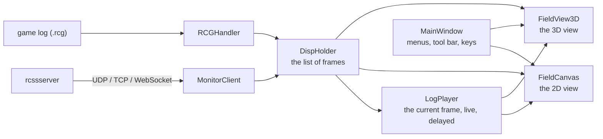
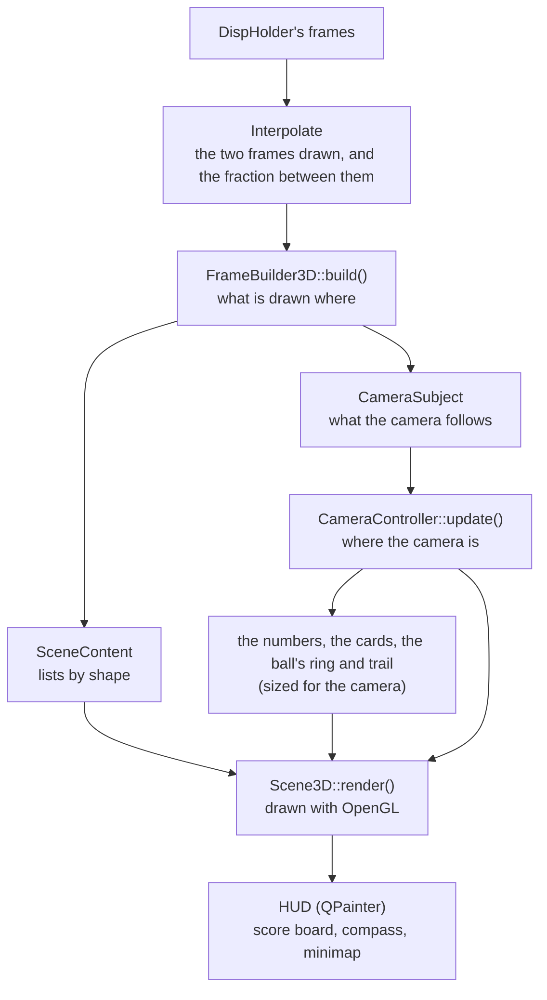
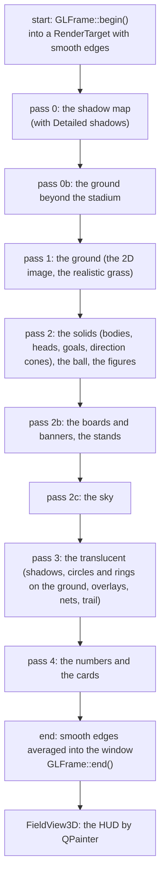
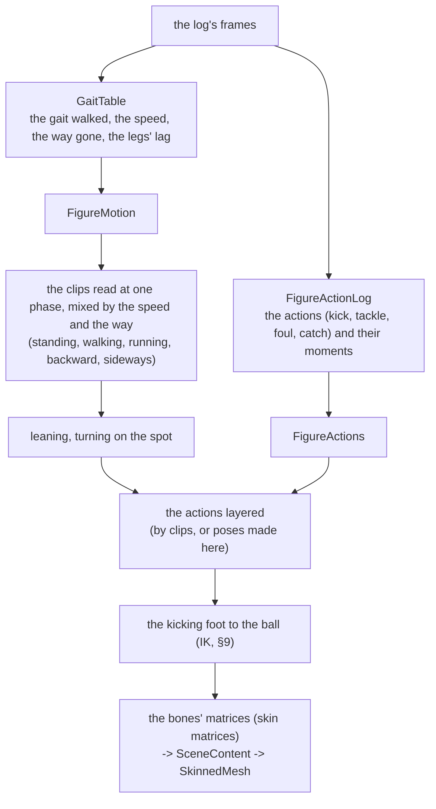

# The 3D view: a guide for developers

| Item | Content |
|---|---|
| For | Developers and maintainers who maintain and improve rcssmonitor's 3D view (including those not versed in 3D graphics) |
| Japanese version | [3d-view.md](3d-view.md) (same content) |
| Distribution | This document is not in the distribution (tarball): `docs/dev/` is left out by `.gitattributes` |

This document explains the code of the 3D view, so that you can read and change it. The description for users is [docs/3d-view.md](../3d-view.md), and the build is described in [docs/build.md](../build.md).

## Contents

1. [About this document](#1-about-this-document)
2. [The basics of 3D graphics](#2-the-basics-of-3d-graphics)
3. [The structure](#3-the-structure)
4. [Coordinates and units](#4-coordinates-and-units)
5. [Time and interpolation](#5-time-and-interpolation)
6. [The source files and classes](#6-the-source-files-and-classes)
7. [Drawing and the shaders](#7-drawing-and-the-shaders)
8. [The human figures and their motion](#8-the-human-figures-and-their-motion)
9. [Inverse kinematics (IK)](#9-inverse-kinematics-ik)
10. [Figure packs and adjusting the models](#10-figure-packs-and-adjusting-the-models)
11. [The ball](#11-the-ball)
12. [The stadium and the scenery](#12-the-stadium-and-the-scenery)
13. [The HUD and input](#13-the-hud-and-input)
14. [Performance](#14-performance)
15. [Tests](#15-tests)
16. [Common tasks](#16-common-tasks)
17. [References](#17-references)

## 1. About this document

### 1.1 Who it is for

- Developers who fix the 3D view's bugs or add to it.
- Maintainers of rcssmonitor. It assumes you know the 2D parts (Qt's widgets, reading game logs, talking to the server), but not 3D graphics (OpenGL, shaders, skeletal animation).

### 1.2 How it is written

- Places in the code are given as `file name` and `Class::function()`. Line numbers are not used; they soon change.
- The comments in the sources are written from the ideas, so that those not versed in 3D can follow them. This document gives the map of the whole and the flows that the comments alone do not make clear. For the details, read the comments in the sources first.
- The diagrams are in Mermaid (GitHub shows them).

### 1.3 Related documents

| Document | Content |
|---|---|
| [docs/plan/2026-11-11_3d-view_en.md](../plan/2026-11-11_3d-view_en.md) | The plan of the 3D view: the reasons of the decisions (D1 to D16), the design (§5), the record of each step (§14) |
| [docs/dev/FIGURE_ASSETS.md](FIGURE_ASSETS.md) | How the figures' material (the bundled models and motions) is made and converted, and the test files |
| [docs/dev/release_en.md](release_en.md) | The steps of a release |
| [docs/3d-view.md](../3d-view.md) | The 3D view for users (cameras, keys, settings) |
| [docs/FIGURE_PACKS.md](../FIGURE_PACKS.md), [docs/FIGURE_PACKS_MIXAMO.md](../FIGURE_PACKS_MIXAMO.md) | Figure packs for users |
| The sources of rcssmonitor-web (the browser version) | The reference implementation of the 3D view (three.js). Many classes' comments name the web version's file they follow |

## 2. The basics of 3D graphics

This chapter tells what the words in this document and in the sources mean, and where rcssmonitor uses them. To learn the ideas properly, the chapters "Getting started", "Lighting" and "Advanced OpenGL" of [LearnOpenGL](https://learnopengl.com/) are good.

### 2.1 The GPU and OpenGL

- The GPU draws the 3D pictures on the screen. A program on the CPU sends shapes (lists of vertices) and images to the GPU, and asks it to draw a shape with some settings.
- **OpenGL** is the rules of asking. rcssmonitor uses **OpenGL 3.3 core** (D1 of the plan). The old way of OpenGL, sending vertices one by one, is not there: shapes are put in the GPU's buffers, and drawn by shaders (below).
- Qt provides the table of OpenGL's functions (`QOpenGLFunctions_3_3_Core`) and a window drawn with OpenGL (`QOpenGLWindow`). OpenGL works on the "current context", so the drawing functions can be called only while the context is current. `QOpenGLWindow` makes it current during `initializeGL()` and `paintGL()`.
- In rcssmonitor, only the parts in `src/view3d/gl/` call OpenGL's functions; the rest of the code uses the parts. The test `gl_isolation` checks this (§15).

### 2.2 Vertices, meshes and triangles

- A 3D shape is a set of **triangles** joining **vertices** (points), a **mesh**.
- Besides its position, a vertex has a **normal** (the direction the surface faces there, for how it is lit) and **texture coordinates** (where on an image it is, the UV). rcssmonitor's vertex is `Vertex3D` (`meshes_3d.h`): 8 floats, 3 of the position, 3 of the normal and 2 of the UV.
- The basic shapes, a cylinder (a player's body), a sphere (the head and the ball), the goal posts and so on, are made by the program in `Meshes3D` (`meshes_3d.cpp`). The human bodies are read from glTF or FBX files (§10).

### 2.3 Transforming the coordinates, and matrices

A vertex passes through several coordinates until it becomes pixels on the screen.

| Coordinates | What they are | The matrix in rcssmonitor |
|---|---|---|
| Model | The shape's own (e.g. a cylinder of radius 1 and height 1) | — |
| World | Where on the pitch (meters) | The model matrix (`Instance3D::model`): moves, turns and scales |
| View | As the camera sees them (the camera at the origin, looking down -z) | The view matrix (`CameraPose::view()`) |
| Clip | Far things made smaller, and what is seen squeezed into a cube from -1 to 1 | The projection matrix (`CameraPose::projection()`) |
| Screen | Pixels | OpenGL maps them to the viewport |

- Each transformation is a product of 4x4 **matrices**, with Qt's `QMatrix4x4`. `translate()`, `rotate()` and `scale()` apply to the shape in the reverse order of the calls (`instance_3d.h` has an example).
- The shaders get one matrix, `uViewProj`, the projection matrix times the view matrix.
- Rotations are given as **quaternions** (`QQuaternion`) as well as angles. Skeletal animation uses quaternions, which blend smoothly.

### 2.4 Shaders

- A **shader** is a small program that the GPU runs while drawing, written in a language called GLSL. Two kinds are used as a pair:
  - The **vertex shader** (`.vert`) runs for every vertex: it moves the vertex from the model's coordinates to the screen's, and passes the normal, the color and so on on.
  - The **fragment shader** (`.frag`) runs for every pixel a triangle covers, and decides its color (lighting, textures, fog, shadows).
- A shader has two kinds of inputs: **vertex attributes**, which differ from vertex to vertex (position, normal and so on; their location numbers in `gl/attributes.h`), and **uniforms**, the same for the whole drawing (the camera's matrix, the sun's direction and so on).
- rcssmonitor's shaders are the 31 files in `src/view3d/shaders/` (15 vertex shaders, 16 fragment shaders), embedded in the program as Qt resources (`view3d_shaders.qrc`). `ShaderProgram::load()` (`gl/shader_program.h`) pairs a vertex shader with a fragment shader (some vertex shaders go with several fragment shaders, and some programs switch parts by a `#define`), and `Scene3D` uses 18 programs. §7 tells their roles.

### 2.5 The depth buffer, culling and translucency

- So that near things hide far ones, the GPU keeps for every pixel how far the nearest thing is (the **depth**, in the **depth buffer**). A new pixel farther than that is not drawn (the **depth test**).
- The triangles at the back of a closed shape cannot be seen, so they are not drawn (**culling**).
- Translucent things are mixed with the colors behind them (**blending**). To mix them right, the opaque things are drawn first, and the translucent ones after.
- `RenderState` (`gl/render_state.h`) sets these for each group of drawing (a **pass**).

### 2.6 Textures

- A **texture** is an image on the GPU, which a shader paints onto triangles: the grass and the lines of the pitch (an image drawn by the 2D drawing), the numbers on the players (`LabelAtlas`), the boards, the stands, and the clothes and skin of the human figures.
- The part is `Texture2D` (`gl/texture_2d.h`). A shader reads it through a numbered "texture unit".

### 2.7 Light and shadows

- How bright a surface is depends on the angle between its direction (the normal) and the light's (**Lambertian reflection**). rcssmonitor's lights are the sun (parallel light) and the soft light from the sky (ambient light).
- **Shadows** come in two ways (the option `shadows_3d`):
  - Simple: a soft ellipse under each player only (the `blob` shaders).
  - Detailed: a **shadow map**. The scene's depths as the sun sees them are drawn first (`ShadowMap`, the `depth` and `skinned_depth` shaders), and drawing the ground compares whether a point is in the shadow of something as seen from the sun (the `shadow` shaders).
- The ground beyond the stadium is brought nearer the horizon's color by **haze** the farther it is, which gives depth (`Scenery3D`; not the players and other solids; §7.5).

### 2.8 Skeletons and skinning

- A human body is a tree of **bones** (joints), the **skeleton**, and a skin (a mesh) on it. When the bones turn, the skin moves with them.
- Each vertex has **weights** for up to 4 nearby bones (how much it moves with each). The vertex shader moves the vertex by the bones' matrices mixed by the weights. This is **skinning** (`SkinnedMesh`, the `skinned` shaders).
- The data of an animation (a **clip**) is the bones' rotations and moves at each time. rcssmonitor does not play the clips as they are: it blends them at the speed and time decided from the log, to make a pose (§8).
- Skeletons differ in the number and the names of their bones. rcssmonitor maps the bones to **roles**, such as "hips" and "left knee", and moves a motion from one skeleton to another (**retargeting**; `HumanoidRig`).

### 2.9 Instanced drawing

- The 22 players' bodies are the same cylinder drawn at different places, sizes and colors. The shape is sent to the GPU once, and in every frame only the list of places and colors is sent and drawn with one command. This is **instanced drawing** (`InstancedMesh`, `SkinnedMesh`, `BillboardMesh`).
- The number of drawing commands costs the CPU's time, so drawing together makes it fast.

### 2.10 Smooth edges (multisampling)

- The edges of triangles are jagged at the borders of pixels. Keeping several **samples** of color and depth in each pixel, and averaging them at the end, makes them smooth (**multisampling**, MSAA).
- rcssmonitor draws into another framebuffer with samples (`RenderTarget`), then averages it into the window's framebuffer (the option `antialias_3d`).

## 3. The structure

### 3.1 Its relation to the 2D view

The 3D view looks at the same data (the list of frames) as the 2D view, and draws it in another window. Reading game logs, talking to the server and controlling the replay are shared with 2D.



- `DispHolder` (`src/disp_holder.h`) holds the list of the frames received (`rcss::rcg::DispInfoT`: the players, the ball and the play mode of a cycle) and the server's parameters.
- `LogPlayer` (`src/log_player.h`) decides which frame is shown (playing, stepping, live, delayed).
- `MainWindow` (`src/main_window.cpp`) switches between the 2D `FieldCanvas` and the 3D `FieldView3D` in a `QStackedWidget`. The 3D view is made the first time it is switched to (around `MainWindow::toggleView3D()`). The reason it cannot be made (built without the 3D view, no OpenGL 3.3, the offscreen platform) comes from `FieldView3D::unavailableReason()`.
- Some parts are shared by 2D and 3D: the computations of the overlays (`src/overlay_math.h`), the players' colors and looks (`src/player_style.h`), the player selection (`src/player_selection.h`), the referee's menu (`src/referee_menu.h`), and the names of the cameras and of the player camera's options (`src/camera_mode.h`, `src/player_camera_options.h`). The image of the pitch's ground is drawn by the 2D `FieldPainter` (`GroundTexture`).

### 3.2 The flow inside the 3D view

How `FieldView3D` draws a frame (`FieldView3D::paintGL()`):



`FieldView3D::paintGL()` goes roughly in this order:

1. The image of the ground is drawn again only when its colors or options changed (`GroundTexture::draw()` -> `Scene3D::setGround()`).
2. The two frames drawn, and the fraction between them, are decided (`Interpolate::position()`; live, `Interpolate::LiveClock`, and in the delayed view the wait; §5).
3. As in 2D, the player nearest the ball is selected automatically (by the options).
4. When the teams' colors, names or logos changed, the images of the boards, the banners and the stands are made again (`Stadium3D`, `Stands3D`).
5. What is drawn where is decided (`FrameBuilder3D::build()` -> `SceneContent`), with the players' poses, the flying ball and the overlays.
6. When the figure pack changed, the human bodies are sent to the GPU (`Scene3D::setFigureBody()`).
7. The camera follows for the time since the last frame (`CameraController::update()`).
8. The numbers and the cards, and the ball's ring and trail, are added, sized for the camera and the screen.
9. It is drawn with OpenGL (`Scene3D::render()`); §7 tells the order.
10. QPainter draws the HUD over it: the score board, the team logos, the overlays' texts, the compass, the minimap, the FPS (`Guides3D`; §13).
11. While a log plays, live until the newest frame is reached, and while the camera moves, the next frame is drawn at once (`FieldView3D::drawNext()`). Still, nothing is drawn.

### 3.3 The parts that do not know OpenGL, and those that do

The code of the 3D view is split into parts that do not know OpenGL and parts that do, so that the tests can check them (§5.1 of the plan).

| Part | OpenGL | Examples |
|---|---|---|
| Deciding what is drawn | Not known | `FrameBuilder3D`, `SceneBuilder`, `SceneContent`, `Figures3D`, `Cameras3D`, `BallFlight`, `Stadium3D` |
| Drawing | Known | `Scene3D` and the parts in `src/view3d/gl/`, `src/view3d/shaders/` |
| The window and input | Known (Qt provides the context) | `FieldView3D` |

- The deciding parts are tested by making frames from a log and checking what is in `SceneContent` (the players' places, colors, poses): the tests `frame_builder_3d`, `scene_builder` and others.
- The drawing parts are tested by drawing into a framebuffer that is not shown and checking its pixels (the test `scene_3d`).

### 3.4 The build

- CMake's `ENABLE_3D` (ON by default) and whether Qt's OpenGL modules are found decide whether the 3D view is built (the top `CMakeLists.txt`). When it is, `HAVE_3D_VIEW` is defined in `config.h`. The code of the 2D side that concerns the 3D view (the menus, the settings dialog) is in `#ifdef HAVE_3D_VIEW`.
- The sources are gathered into a static library, `rcssmonitor_core` (`src/CMakeLists.txt`), which the program and the tests link. The 3D sources are added in `if(HAVE_3D_VIEW)`.
- The shaders (`src/view3d/shaders/view3d_shaders.qrc`) and the bundled figure packs (`resources/figures/view3d_figures.qrc`) are embedded in the program as Qt resources.
- The bundled libraries: cgltf, which reads glTF (`third_party/cgltf/`, one header), and ufbx, which reads FBX (`third_party/ufbx/`).
- It is built with both Qt5 and Qt6 (D2 of the plan). In Qt6, `QOpenGLWindow` and others moved into the OpenGL and OpenGLWidgets modules; in Qt5 they are in Widgets and Gui. `QT_3D_VIEW_LIBRARIES` in `CMakeLists.txt` hides the difference.
- The autotools build does not include the 3D view (D3 of the plan).

### 3.5 Why the window is a QOpenGLWindow

`FieldView3D` is not a `QOpenGLWidget` but a window of its own (`QOpenGLWindow`), put into the main window by `QWidget::createWindowContainer()`. With a `QOpenGLWidget`, Qt copies the drawn image once more into the main window's, and a 4K screen with an integrated GPU got only 31 frames a second (48 with the window; 9-6 in §14 of the plan). In exchange, being another window needs some care:

- A click does not close a menu: Qt does not close an open menu on a click in a window of its own, so `PopupCloser` closes it.
- It takes no keyboard input: the keys go to the main window's actions.
- Wayland and XWayland: at high resolutions, going through XWayland is slow ("Running smoothly" in [docs/3d-view.md](../3d-view.md) for users).

## 4. Coordinates and units

### 4.1 The field's coordinates (the log and 2D)

- rcssserver's field has x along the pitch (the left goal at x = -52.5, the right at +52.5) and y across it (-34 to +34), in meters. The 2D view draws y downward (the top of the screen is y = -34).
- The directions of a player's body and neck are in degrees: 0 along positive x, positive turning toward positive y (down on the 2D screen).

### 4.2 The 3D world's coordinates

- The 3D world has **x along the field's x, z along the field's y, and y up**, in meters (as the web version's `scene-math.ts`). The ground is the plane y = 0.
- The bottom of the 2D screen (positive y of the field) is the side of positive z in 3D. The broadcast camera is high on the side of positive z (beyond the near touch line), looking toward negative z: the same way as the 2D view is seen.
- A field direction (degrees) becomes a 3D rotation about the y axis (up). The comments of `SceneBuilder` and `Figures3D` tell the signs. When in doubt, see the tests (the direction cones checked in `scene_builder`).

### 4.3 Other units

| Quantity | Unit | Notes |
|---|---|---|
| Length | Meters | The ball's radius is 0.085 m by default (the server's `ball_size`); in 3D it can be changed by the option `ball_size_3d` |
| Speed | Meters per cycle | The server's unit. `BallFlight` turns gravity into m/cycle² |
| Time | Cycles | A cycle is the server's `simulator_step` (100 ms by default) |
| Screen | Logical pixels | Times the screen's scale (e.g. 1.5) are physical pixels. OpenGL's framebuffers are in physical pixels |
| Angles | Degrees | Qt's `rotate()` takes degrees; the trigonometric functions radians |

## 5. Time and interpolation

### 5.1 Frames and cycles

- `DispHolder` has one frame for each cycle of the server (in a stopped time, frames told apart by the stopped time follow). The 2D view draws the current frame as it is.
- The 3D view draws about 60 times a second, so it draws the positions **between** two frames. Without that, the players and the ball would jump 10 times a second.

### 5.2 Interpolating between frames

- `Interpolate` (`interpolate.h`) decides the two frames drawn (`Position::index`, `next`) and the fraction between them (`alpha`, 0 to 1), and makes the show between them (`Interpolate::show()`).
- Positions are mixed linearly, and the body direction turns the short way round (`lerpAngle()`). A play mode change, and an object that jumped farther than it can move in a cycle (a placement), are not mixed.
- While a log plays, `LogPlayer::alpha()` (the time since the last step over the time of a frame) is the fraction; stopped, it is 0.
- An important rule: **the poses and the ball's height are decided from the frames and the fraction only** (§5.2 of the plan). A frame looks the same however it is reached: paused, stepped back, jumped to. So some tables are made from the log when it is read, and kept (`GaitTable`, `BallSpin`, `BallFlight`).

### 5.3 The live clock

- Live, the view is drawn two cycles behind the newest frame (`Interpolate::LIVE_DELAY`). The figures wind up for an action looking two frames ahead, which then are at hand (§8).
- The times the frames come vary with the network. Following each coming would make the ball jerk. `Interpolate::LiveClock` keeps a clock going at the simulation's speed, brought gently toward the target (`Interpolate::liveTime()`). It never goes back, and jumps only when far from it.

### 5.4 The delayed live view

- In the delayed live view (Live Delay, §5.10 of the plan), `LogPlayer` keeps the frame the 2D view shows a fixed number of frames behind the newest (`LogPlayer::liveIndex()`). The 3D view passes the same delay in frames to `Interpolate::liveTime()`, and draws the same time interpolated.
- Right after connecting, until the delay's frames have come, the first frame is drawn (`Interpolate::waitingLive()`). Meanwhile the 3D clock is not used (it would run past a target that does not go on, and jump back, again and again).
- In the delayed view, the frames ahead of the time drawn are at hand, so the ball can fly (§11).

## 6. The source files and classes

The 3D view's sources are in `src/view3d/` (the OpenGL parts in `src/view3d/gl/`, the shaders in `src/view3d/shaders/`), here by role. The comments at the top of each file and of its classes tell the details.

### 6.1 The window and input

| File | Class | Role |
|---|---|---|
| `field_view_3d` | `FieldView3D` | The window of the 3D view (`QOpenGLWindow`): drawing a frame (§3.2), the mouse, the HUD, measuring the time |
| `popup_closer` | `PopupCloser` | Closes an open menu on a click in the 3D window (§3.5) |
| `fps_meter` | `FpsMeter` | The frames drawn a second and the GPU's time (the option `fps_3d`) |

### 6.2 Time

| File | Class | Role |
|---|---|---|
| `interpolate` | `Interpolate` (namespace), `Position`, `LiveClock` | The two frames drawn and the fraction, the show between them, the live clock, the time of the delayed view (§5) |

### 6.3 Deciding what is drawn (not knowing OpenGL)

| File | Class | Role |
|---|---|---|
| `frame_builder_3d` | `FrameBuilder3D`, `View3DState` | Decides what a frame draws: the show between the frames, the players (cylinders or figures), the ball, the overlays, what the player camera's player perceives, what the cameras follow. The tests make frames with it too |
| `scene_builder` | `SceneBuilder` | From a show, puts the goals, the players' bodies and heads, the direction cones, the stamina bars, the numbers and the ball in the lists by shape |
| `scene_content` | `SceneContent` and others | What a frame draws (the lists of instances by shape, the figures' poses, the overlays, the targets of clicks) |
| `instance_3d` | `Instance3D`, `ColorVertex3D`, `Billboard3D` | A copy of a shape (a model matrix and a color), a vertex with its color, a rectangle facing the camera |
| `overlay_builder` | `OverlayBuilder` | Turns the overlays of 2D (lines, dotted lines, dots, view areas) into vertices on the ground |
| `label_atlas` | `LabelAtlas` | The 22 players' numbers side by side in one image (so that one texture serves them) |
| `meshes_3d` | `Meshes3D`, `Vertex3D` | Makes the basic shapes (cylinder, sphere, cone, quad and so on) |
| `guides_3d` | `Guides3D` | The compass and the minimap (drawn by QPainter; §13) |

### 6.4 Cameras

| File | Class | Role |
|---|---|---|
| `camera_3d` | `CameraPose` | Where a camera is, where it looks, its field of view, and the view and projection matrices |
| `cameras_3d` | `Cameras3D` (namespace), `CameraController` | Where each kind of camera is, following the ball or a player smoothly, the mouse, the viewpoints of the whole pitch |
| `player_camera_3d` | `PlayerCamera3D`, `PlayerCameraState` | The player camera (at the eyes or over the shoulder, its direction, motion, field of view) |
| `sight` | `PlayerSight`, `Perceptions` | How the player camera's player perceives the other players and the ball (the server's rules of seeing) |
| `picking` | `Picking`, `Ray` | From the point clicked, finds the player or the ground it aims at (the referee's menu) |
| (`src/camera_mode.h`) | `CameraMode`, `Viewpoint` | The names of the cameras and viewpoints (options, menus, command line) |
| (`src/player_camera_options.h`) | `PlayerCameraOptions` | The values of the player camera's options |

### 6.5 Drawing (knowing OpenGL)

| File | Class | Role |
|---|---|---|
| `scene_3d` | `Scene3D` | Holds the GPU's resources and draws in passes (§7). It only combines the parts; the OpenGL calls are in them |
| `gl/shader_program` | `ShaderProgram` | Reads a pair of shaders and sets their uniforms |
| `gl/attributes` | `GLAttribute` | The location numbers of the vertex attributes (the same numbers in the shaders and in C++) |
| `gl/frame` | `GLFrame` | The start and the end of a frame (the framebuffer, the viewport, clearing) |
| `gl/render_state` | `RenderState` | How a pass draws (depth test, culling, blending) |
| `gl/render_target` | `RenderTarget` | The framebuffer with samples for smooth edges |
| `gl/shadow_map` | `ShadowMap` | The sun's shadow map (a texture of depths only) |
| `gl/texture_2d` | `Texture2D` | An image on the GPU |
| `gl/instanced_mesh` | `InstancedMesh` | A shape and its copies drawn together |
| `gl/skinned_mesh` | `SkinnedMesh` | A human body and its copies (22 players), moved by the bones' matrices and drawn together |
| `gl/billboard_mesh` | `BillboardMesh` | Rectangles facing the camera (numbers, cards) drawn together |
| `gl/vertex_batch` | `VertexBatch` | Lines, points and triangles whose shape changes every frame (overlays, view areas) |
| `gl/gpu_timer` | `GpuTimer` | Measures how long the GPU takes to draw |
| `shaders/*.vert`, `*.frag` | — | The shaders (15 vertex, 16 fragment; §7) |

### 6.6 The scenery and the stadium

| File | Class | Role |
|---|---|---|
| `ground_texture` | `GroundTexture` (namespace) | Draws the image of the pitch with the 2D `FieldPainter` |
| `grass_3d` | `Grass3D` | The realistic grass (patches and wear: what goes into the ground image, and what the shader draws) |
| `scenery_3d` | `Scenery3D` | The sky, the haze, the ground beyond the stadium (the same computations as the shaders, for the tests) |
| `sun_3d` | `Sun3D` | Where the sun is, and the camera of the shadow map |
| `stadium_3d` | `Stadium3D`, `TeamLook` | The boards in the team colors, and the banners with the team names and logos |
| `stands_3d` | `Stands3D`, `Stand` | The stands' shapes and the images of the fans |

### 6.7 The ball

| File | Class | Role |
|---|---|---|
| `ball_3d` | `Ball3D`, `BallSpin` | The ball's pattern and its rolling along its way (a table made from the log and kept) |
| `ball_aids_3d` | `BallAids3D`, `TrailPoint` | The ring around the ball, and its trail |
| `ball_flight_3d` | `BallFlight` | The flying ball (segments, reasons to loft, the upward speed, grounding in the delayed live view; §11) |

### 6.8 The human figures

| File | Class | Role |
|---|---|---|
| `figures_3d` | `Figures3D` | Holds the figure pack's models and motions, and makes each player's pose (the bones' matrices). The kicking foot's IK is here too (§9) |
| `humanoid` | `HumanoidRig`, `HumanoidPose` | Maps a skeleton's bones to roles, and reads and writes poses any skeleton can take (retargeting) |
| `gait_table` | `GaitTable` | How many cycles of the gait each player has walked by each frame, and how fast (made once from the log and kept) |
| `figure_actions` | `FigureActionLog` | Reads the times of the actions from the state bits (kick, tackle, catch, foul) |
| `figure_pack` | `FigurePack`, `FigurePacks` | Finds and reads the figure packs (`figure.json`) |
| `figure_looks` | `FigureLooks`, `FigureCast` | Each player's body, hairstyle, and skin and hair colors |
| `figure_uniform` | `FigureUniform` | Paints the uniforms (the planes where the clothes end, how each material is painted) |

### 6.9 Reading the models

| File | Class | Role |
|---|---|---|
| `gltf_model` | `GltfModel` | Reads glTF and VRM with cgltf, holding the skeleton, the skin and the clips (the other formats are read into this form too) |
| `fbx_model` | `FbxModel` | Reads FBX with ufbx into a `GltfModel` (Mixamo's files as they are) |
| `bvh_model` | `BvhModel` | Reads BVH (motion capture) into a `GltfModel` (a skeleton and one clip) |

### 6.10 Files of the 2D side that concern the 3D view

| File | How it concerns 3D |
|---|---|
| `src/main_window.cpp` | Making and switching the 3D view, the menus and the tool bar of the cameras and viewpoints, the keys |
| `src/options.{h,cpp}` | The 3D options (the group `View3D`), the command line |
| `src/config_dialog.cpp` | The 3D, Players & Ball and Camera tabs of the settings dialog |
| `src/log_player.{h,cpp}` | The fraction of the interpolation (`alpha()`), live, the delayed view |
| `src/overlay_math.h`, `src/player_style.h`, `src/player_selection.h`, `src/referee_menu.h` | Computations and looks shared by 2D and 3D |

## 7. Drawing and the shaders

### 7.1 The order of the passes

`Scene3D::render()` draws a frame in several **passes**. A pass decides how to draw (`RenderState`), selects a shader program (`ShaderProgram::bind()`), sets its uniforms, and draws lists of shapes (`InstancedMesh::draw()` and so on). The order matters: the opaque things first, the translucent ones after, the texts last of all.



| Pass | What it draws | Program (vertex / fragment) | Render state |
|---|---|---|---|
| Start | Clears the framebuffer to the horizon's color (with the sky) or the background (`GLFrame::begin()`) | — | — |
| 0 | The shadow map: the depths of the solids that cast shadows (bodies, heads, goals, figures) as the sun sees them. Not the ball nor the cones | `depth`; the figures `skinned` + `depth`, their see-through parts (hair) `skinned` + `skinned_depth` | opaque |
| 0b | The ground beyond the ground image (on into the haze) | `outside` | opaque |
| 1 | The ground: the 2D image (texture unit 0), the realistic grass's noise (unit 2) | `ground` | opaque |
| 2 | The solids: cylinders (bodies), spheres (heads), cones (directions), the goals | `lit` | opaque |
| 2 (ball) | The ball and its pattern | `ball` | opaque |
| 2a | The human figures (bodies posed by their bones' matrices, the uniforms) | `skinned`; the parts with textures `skinned` (`TEXTURED`) | opaque |
| 2b | The boards and the banners (an image on the front, the back plain) | `panel` | opaqueTwoSided |
| 2b' | The stands (not one with the camera inside it) | `stand` | opaque |
| 2c | The sky dome, after the solids, only where none of them is | `sky` | sky |
| 3 | The translucent: shadows (Detailed: the plane reading the shadow map on unit 1; Simple: ellipses), the circles and rings on the ground, the ball's ring, the overlays (sectors, lines, points, dotted lines), the nets, the ball's trail; from the low layers up | `shadow` or `blob`, `flat`, `ring`, `colored` | translucent |
| 4 | The numbers and the cards, facing the camera, from far to near | `billboard` | overlay |
| End | Averages the samples of smooth edges into the window's framebuffer (`RenderTarget::resolve()`), and sets OpenGL back as QPainter expects it (`GLFrame::end()`) | — | — |

After this, `FieldView3D::paintGL()` puts the HUD over it with QPainter (§13).

### 7.2 How a pass draws (RenderState)

`RenderState` has four settings: the depth test, writing the depth, culling the back faces, and blending. OpenGL keeps settings until they are changed, so every pass sets all of them again (so that nothing is left from the pass before).

| Name | Depth test | Depth write | Back faces culled | Blending | Used for |
|---|---|---|---|---|---|
| `opaque()` | yes | yes | yes | — | The ground, the solids, the ball, the figures, the stands |
| `opaqueTwoSided()` | yes | yes | — | — | The boards and the banners (seen from behind too) |
| `sky()` | yes | — | — | — | The sky (drawn only where no solid is, leaving no depth) |
| `translucent()` | yes | — | — | yes | Shadows, circles on the ground, overlays, nets. They write no depth, so the order of drawing decides which is over which |
| `overlay()` | — | — | — | yes | The numbers and the cards (over everything) |
| `painter()` | — | yes | — | — | The state handed to QPainter |

### 7.3 The shaders

The shader files are in `src/view3d/shaders/`, each with its role and inputs in its leading comment. `ground.vert` and `ground.frag` explain how a vertex shader and a fragment shader work at all: read them first.

| Program | Draws | Main inputs and computation | The same computation on the CPU |
|---|---|---|---|
| `ground` | The ground | Paints the 2D image. With the realistic grass, the mowed stripes light or dark by the way the camera looks, and the blades' noise near the camera only (`uRealistic`, `uCamera`, `uNoise`) | `Grass3D` |
| `outside` | The ground beyond | Its color, and the haze by the distance from the camera (`uHazeFrom` to `uHazeTo`) | `Scenery3D::haze()` |
| `sky` | The sky | A color from the horizon to the zenith by how high the direction is; below the horizon, the haze's color of the ground beyond | `Scenery3D::skyColor()` |
| `lit` | The solids | Ambient 0.42 + the sky's light 0.22 x (0.5 + 0.5 x the normal's upward part) + the sun 0.5 x max(normal . sun, 0). The normal is turned by the "normal matrix" (the inverse transpose of the model matrix) | — |
| `ball` | The ball | The light of `lit`, with the pattern of 12 pentagons at the corners of an icosahedron, found at each pixel from the direction on the ball before it is turned (so the edges stay sharp near the camera) | `Ball3D::patternAt()` |
| `skinned` | The figures | Moves the vertices by the bones' matrices (§7.6), with the light of `lit`. How each part is painted (`uPaint`: the material's color, the team's color, the uniform, the hair, the skin) and the planes where the clothes end (`uCuts`). The `TEXTURED` variant handles textures and see-through parts (hair cards) | `FigureUniform` |
| `depth` | The shadow map's depths | Only the positions, by the sun's camera (`Sun3D::shadowViewProj()`); no colors | — |
| `skinned_depth` | The depths of the figures' see-through parts | A transparent part of a texture casts no shadow | — |
| `shadow` | The plane of the shadows (just over the ground) | Reads the shadow map by comparison (`sampler2DShadow`), averaging a few offset points to soften the edges; a margin of about 7 cm against the map's rounding | — |
| `blob` | The Simple shadows | Stretches the unit disc into an ellipse away from the sun, dark in the middle, fading at the edge | `Sun3D::blobShadow()` |
| `flat` | Flat colors | The circles and rings on the ground, the ball's shadow, the nets; translucent by the color's alpha | — |
| `ring` | The ball's ring | A ring of a kept line width and a faint fill on a square (smoothed over a pixel) | — |
| `colored` | The overlays | Each vertex's color; dotted lines cut by the distance along the line (`DISTANCE`) | — |
| `panel` | The boards and banners | The image on the front, the back plain (`gl_FrontFacing` tells which) | — |
| `stand` | The stands | The fans' image, with the light of `lit` | — |
| `billboard` | The numbers and cards | Spreads a square along the rows of the view matrix (the camera's right and up) so that it faces the camera; tints the image by the color | — |

### 7.4 Vertex attributes and instances

- The location numbers of the vertex attributes are in `GLAttribute` of `gl/attributes.h` (position 0, normal 1, UV 2, the model matrix 3 to 6 (a mat4 takes 4), color 7, the distance of a dotted line 8, the joints 9, the weights 10, and so on). `ShaderProgram` adds `#version 330 core` and `#define A_POSITION 0` and the rest at the top of a shader before compiling it; the shaders write `layout( location = A_POSITION )`.
- Some attributes belong to a vertex (the same for every copy of a shape) and some to an instance (each copy's place and color). The instance's attributes are set with a "divisor" of 1: OpenGL steps to the next value once per instance (`InstancedMesh::create()`).
- `BillboardMesh` puts attributes of its own at the same locations instead of the model matrix. `VertexBatch` has no instances: each vertex has its color.

### 7.5 Light, haze and shadows

- The light is the sum of three in `lit.frag` (the row `lit` above), tuned by looking. The figures (`skinned.frag`) and the stands (`stand.frag`) use the same computation; change the three together.
- The sun's direction is in `Sun3D` (beyond the far touch line, on the left, 44 degrees up). Seen from the near side, the shadows fall toward the camera, on the right.
- The haze covers only the ground beyond the stadium (`outside`) and the sky (`sky`), not the players nor the stands.
- With Detailed shadows: pass 0 draws the shadow map, and in pass 3 the plane of the shadows reads it. The plane is a translucent black just over the ground (`Sun3D::SHADOW_PLANE_Y`), as dark as `Sun3D::SHADOW_OPACITY`. The area and the height the map covers are constants of `Sun3D` (4 m, for a tall figure with both arms up).
- With Simple shadows: pass 3 only draws an ellipse for each player; no shadow map is drawn.

### 7.6 Skinning on the GPU

- A vertex of a human body has the numbers and weights of up to 4 bones (`SkinVertex`, `GltfModel`). Each player's pose is the list of its bones' **skin matrices** (each moving a bone from its rest pose to its pose now), made by `Figures3D::pose()`.
- The matrices of 22 players times tens of bones do not fit in uniforms, so they go into a texture (`uJoints`: a row a player, 4 texels a bone (the matrix's 4 columns)). The vertex shader reads its row by `gl_InstanceID` and the columns by the bone's number (`skinned.vert`).
- The parts without a texture or a see-through part are drawn by the light variant; those with one (hair cards, eyelashes) by the `TEXTURED` variant. In the shadow map too, `skinned_depth.frag` drops the transparent places of the see-through parts.

### 7.7 Changing a shader

- The shaders are embedded in the program as Qt resources: build again after changing them. Add a new file to `view3d_shaders.qrc`.
- When compiling or linking fails, an error starting with `(ShaderProgram) ...` goes to the standard error, `Scene3D::initialize()` fails, and the 3D view cannot be used. Write GLSL in the way of 3.30 core (an `out` variable, not `gl_FragColor`).
- Some shaders have the same computation on the CPU (the right column of the table). The tests check colors and shapes by the CPU's computation, so when a shader changes, change its CPU side the same way.
- What is drawn is checked by the test `scene_3d` in a framebuffer that is not shown (§15).
- Measure the time with `RCSSMONITOR_3D_TIMING` and the FPS display (§14). To capture a drawn frame and look into it step by step, an outside tool such as RenderDoc can be used.
- Do not use OpenGL's functions and constants outside `src/view3d/gl/` (the test `gl_isolation`). When a new way of drawing is needed, add a part, or a function of a part.

### 7.8 Drawing something new

The steps in the comment of the class `Scene3D`, in detail:

1. Add the shape to `Meshes3D` (of unit size, at the origin).
2. Give `Scene3D` an `InstancedMesh` of the shape, made in `initialize()` and destroyed in `release()`.
3. Add a list of instances to `SceneContent`.
4. Fill the list with instances (model matrices and colors) in `SceneBuilder` (or `FrameBuilder3D`).
5. Add its `draw()` to the pass of the right shader and render state in `Scene3D::render()`. For a new shader, make its files in `src/view3d/shaders/`, add them to the `.qrc`, and `load()` it in `initialize()`.
6. Add tests: what is in the lists in `scene_builder` or `frame_builder_3d`, the pixels drawn in `scene_3d`.

## 8. The human figures and their motion

The detailed rules of the figures' motion, and their reasons, are in §5.8 and §5.9 of the plan, and in the records 7-1 to 7-5 and 9-1 to 9-5b of §14. This chapter gives the flow of the whole and hints for reading the code.

### 8.1 The principle: a pose comes from the frame and the fraction only

- A figure's pose is not "played" from the pose before: it is **made again at every drawing from the log's frames and the fraction only** (§5.2). Paused, stepped back or jumped to, a frame gets the same pose.
- So ways that depend on the pose before (motion matching and the like) are not used. The only information beyond the frames is the table made when the log is read (`GaitTable`).
- In the web version (three.js), the animation mixer did not rewrite the bones whose values did not change, so the rotations layered over them piled up and the neck and the body kept turning. Making everything again every time avoids that.

### 8.2 How a pose is made

A player's pose is made roughly in this order (`FrameBuilder3D` -> `Figures3D::pose()`):



1. **The motion** (`FigureMotion`): `GaitTable` holds, for each player at each frame, how much it has walked (in cycles of the gait, two steps a cycle), its speed, the angle between the way it goes and its body direction, and how far its legs lag behind its body when it turns on the spot. It is made once when the log is read.
2. **The actions** (`FigureActions`): `FigureActionLog` reads from the runs of the state bits (kick, tackle, catch, foul) which action it is and the time from its moment.
3. **Walking and running**: the clips of standing, walking, jogging and sprinting are read at one phase, with the left foot's contact aligned, and mixed by the speed. With clips of going sideways or backward, they are mixed by the way gone (§8.4).
4. **Leaning and turning**: the figure leans toward its acceleration (forward when speeding up, back when slowing down, in when turning). Turning on the spot, the hips turn back toward the legs, and stepping is mixed in.
5. **The actions**: the neck, the kick, the sliding tackle, sitting down after a foul, the goalie's catch and dive, and pointing are layered by their weights, which rise before the action's moment and fall after it. A clip is used if there is one; otherwise a pose made here (after the web version's `pose.ts`).
6. **IK**: around a kick's moment, the kicking foot goes to the ball (§9).
7. **The bones' matrices**: the rotations by role (`HumanoidPose`) are put on the body's skeleton (`HumanoidRig::apply()`), and each bone's skin matrix is made. The GPU moves the vertices (§7.6).

### 8.3 Bones and roles (retargeting)

- `HumanoidRig` maps a skeleton's bones to **roles** (the names of VRM's Humanoid, `HumanBone`): hips, spine, chest, neck, head, shoulders, upper arms, lower arms, hands, upper legs, lower legs, feet, toes and so on. A bone without a role (the fingers and so on) keeps what the caller gives it.
- A pose is a "normalized rotation" for each role (`HumanoidPose`): how far it turned from the rest pose (a T pose), seen from its parent role, in directions that are the same on every skeleton. A clip read into this form by `HumanoidRig::poseOf()` and put on another skeleton by `apply()` makes the same motion on a different skeleton (**retargeting**).
- What makes up for the skeletons' differences:
  - A model in an A pose (arms down at rest) is turned into a T pose first (`HumanoidRig::restTurn()`).
  - A model whose up is not +y is stood up (`HumanoidRig::upAxis()`), and one not facing +z is turned to face +z.
  - The hips' bob is scaled by the ratio of the legs' lengths, and the horizontal movement comes from the log. Lengths are in hip heights.
- The map of bone names to roles is a preset (`quaternius`, `mixamo`, `vroid`, `vrm`, `xsens`) or written in the pack's `figure.json` (§10).

### 8.4 Walking and running

- **Mixed at one phase**: timing each clip by "the distance walked / the clip's speed" makes the legs cross when mixed. rcssmonitor finds from each clip itself when the left foot comes down and its stride (how fast a foot on the ground goes back) (`Figures3D::analyzeGait()`), and reads all the clips at one phase. The phase goes on by the distance walked over the mixed stride: the feet do not slide.
- **Mixed by the way**: with clips of going sideways and backward, the clips of the two ways on either side of the way gone are mixed by weights that make a foot on the ground go along the way (`GaitWays::mixAt()`). Up to 30 degrees from forward and backward (`GaitWays::TWIST_FULL`), the clips are not mixed but the hips are twisted that way. With clips of one side only, the other side's is made by mirroring.
- **Turning on the spot**: the legs' direction lags behind the body's, as its average over the last 3 cycles (`GaitTable::TURN_LAG`). Standing, the hips turn back toward the legs (up to 45 degrees, `Figures3D::TURN_TWIST_MAX`), and stepping is mixed in by how fast it turns (a step each 90 degrees, `GaitTable::TURN_STEP_ANGLE`).
- After a jump farther than a cycle allows (a placement, `GaitTable::TELEPORT`), and for a player out of the game, the legs start again in the body direction.

### 8.5 The actions

- An action's **moment** is when it meets the ball. rcssserver sets the bit and then moves the ball, so the moment is the frame before the bit's first (the web version was a cycle late).
- An action winds up before its moment, so it looks two frames ahead. Live, the view is drawn two cycles behind the newest frame, which keeps those frames at hand (`Interpolate::LIVE_DELAY`, §5.3).
- The main actions, with hints for looking into them:

| Action | How it is decided | Main constants (`figures_3d.h`, `figure_actions.h`) |
|---|---|---|
| Kick | The foot on the ball's side meets it at the moment. A light touch, a pass with the inside of the foot, or a shot with a long swing, by the power and the direction. IK around the moment (§9) | `KICK_TAP_WEIGHT`, `REACH_BEFORE`, `REACH_AFTER` |
| Sliding tackle | Slides while the bit stays, holds a while after the last, gets up | — |
| Foul | After the tackler slid in, sits down with the hands on the ground behind. A clip plays from partway | `FOULED_START` |
| Getting up | Plays the clip of getting up to end with the action (when the player can go). Faster if it cannot otherwise, its start left out if even that is not enough (`upSchedule()`) | `UP_SPEED_MAX`, `UP_BLEND` |
| Catch | By the ball's height: crouching with the hands near the ground for a low ball, both hands up for a high one. The body turns toward the ball | `CATCH_TURN` |
| Dive | Mixed in for a ball farther than 0.8 m to the side, all of it from 1.2 m | `DIVE_FROM`, `DIVE_FULL` |
| Pointing | The arm on that side points (the chest turns for far to the side or behind). A clip cannot point where it must, so the pose made here only | — |

- A clip's moment is the one written in `figure.json`, or else found from the clip (a kick: when a foot swings forward fastest; a slide and a fall: when the hips come down to 40% of their height (`DOWN_HIPS`); the catch and the dive: when the middle of the hands is farthest from the chest).
- A clip going somewhere (the hips moving farther than 30% of their height, `ACTION_TRAVEL`) keeps its hips horizontally where they start.

### 8.6 The figures' size

- A figure is a person's height 1.85 m (`SceneBuilder::PERSON_HEIGHT`) x the player's height ratio x the scale (the option `figure_scale_3d`, 1.0 by default) tall.
- The height ratio is the kickable area of the player's type (player_size + kickable_margin) over that of the default type (0.9 to 1.1 with the default parameters; `SceneBuilder::heightRatio()`).
- A player whose number the player camera does not know for sure is mixed toward the default height (so that its height does not tell who it is).

### 8.7 Adjusting the motion

- The motion has been adjusted by looking at it on the screen. Most of the values are constants in `figures_3d.h` and `gait_table.h`, each with a comment of its meaning and unit. The reasons and history are in §14 of the plan (search for "7-2", "9-5a" and so on).
- The tests (`figures_3d`, `figure_actions`, `gait_table`, `humanoid`) check the results as the bones' places and directions (e.g. whether the kicking foot reaches the ball, whether the knee bends forward), with logs and clips made from the bundled Mannequin.
- The look is checked by drawing in a window not shown (9-6 in §14 of the plan) and by replaying real logs.

## 9. Inverse kinematics (IK)

### 9.1 What IK is

- **Forward kinematics** finds where the end (a hand, a foot) is from the bones' rotations. Playing a clip is this.
- **Inverse kinematics** (IK) is the reverse: from where the end should be, it finds the bones' rotations. For example, how far to turn the thigh and the shin so that the foot meets the ball.
- rcssmonitor's IK is the **two-bone IK** of the thigh and the shin. The two bones and the goal make a triangle, so the answer comes by a formula (no iteration).

### 9.2 The computation of the two-bone IK

Let H be the hip joint, a the thigh's length, b the shin's, and T where the ankle should be.

```
        H (hip)
        |\
      a | \ d = |T - H|
        |  \
        K---T (the ankle's goal)
          b
```

1. Bring the distance d from H to T within reach (|a - b| < d < a + b).
2. By the law of cosines, the angle θ at the hip: cos θ = (a² + d² - b²) / (2 a d).
3. Decide which way the knee goes (bends; the **pole**): the part of the body's front (the model's +z) perpendicular to the way from H to T. When the leg points nearly forward and it is undecided, the side the knee is on now.
4. The knee's goal K = H + (the way to T) x a cos θ + (the pole) x a sin θ.
5. Turn the thigh from where the knee is now toward K, and the shin so that the ankle comes onto the way to T.

### 9.3 Its use in rcssmonitor: the kicking foot to the ball

- `Figures3D::reach()` brings the kicking foot to the ball around a kick's moment:
  1. The weight w (`Figures3D::reachOf()`) rises from 0.4 cycles before the moment (`REACH_BEFORE`), is 1 at the moment, and 0 at 0.3 cycles after it (`REACH_AFTER`). Not during a tackle or a foul. For a light touch, it follows that pose's weight.
  2. In the pose so far (the clips and the actions layered), the hip, the knee, the ankle and the toes are found in the model.
  3. The target is behind the ball, at its center's height, against the way it is kicked (`Figures3D::kickTarget()`). The toes go toward the target by w, and the ankle's goal keeps the ankle where it is from the toes.
  4. The thigh and the shin are turned by the computation of §9.2. The foot is turned back by the thigh's and the shin's turns, so that it keeps its direction (the foot does not twist oddly).
- The turns are added to the roles (`HumanoidRig::turnInModel()`), so it works the same on the skeleton of any figure pack.
- The test `figures_3d` checks that the foot (the Mannequin's bone `ball_r`) reaches the ball at the moment, the shape of the weight's peak, and that it is not used during a tackle.

### 9.4 Where IK is not used

- The other actions (the catch's hands, the pointing arm, sitting down) are rotations made here (each limb's swing from hanging down, its turn and its bend), not IK. There is no IK putting the hands exactly on the ball yet.
- There is no IK planting the feet on the ground either. Walking keeps the feet from sliding by aligning the phase and the stride (§8.4).
- To add an IK, follow `Figures3D::reach()`: find the places in the pose so far, move toward the goal by a weight, add the turns to the roles, and check the end's place in a test.

## 10. Figure packs and adjusting the models

The format of figure packs and how to make them are in [docs/FIGURE_PACKS.md](../FIGURE_PACKS.md) and [docs/FIGURE_PACKS_MIXAMO.md](../FIGURE_PACKS_MIXAMO.md) for users, and how the bundled material is made in [docs/dev/FIGURE_ASSETS.md](FIGURE_ASSETS.md). This chapter gives the code behind them, and how to think about adjusting a model.

### 10.1 Finding and reading the packs

- A figure pack is a folder with `figure.json` and the files of the models and motions. The bundled `mannequin` and `human` are in the same format in `resources/figures/`, embedded as resources.
- `FigurePacks` looks in the bundled ones (`:/figures`), the folder of the user's choice (the option `figure_folder_3d`), and `rcssmonitor/figures` of the XDG data folders (first `~/.local/share/rcssmonitor/figures`), in this order. A folder's name is the pack's name.
- `FigurePack` reads `figure.json` (format 1). Unknown keys are skipped (so that a pack of a later version can be read). Why a pack cannot be read (the line and column of a JSON error, a missing file, an unknown skeleton, a missing clip and so on) is shown in the settings dialog.
- When a pack is chosen, `Figures3D::setPack()` reads its models and motion, and the bodies go to the GPU (`Scene3D::setFigureBody()`). A motion shared by packs is read once.

### 10.2 Reading the models, and bringing them into line

- Every format is read into the same form (`GltfModel`: the skeleton, the skin, the materials, the clips):
  - glTF and VRM: cgltf (`GltfModel`). A required extension that cannot be read (a compression and so on) is a reason the model cannot be read.
  - FBX: ufbx (`FbxModel`), converted to y up, a person facing +z, meters. The takes are the clips (30 keys a second).
  - BVH: our own (`BvhModel`): a skeleton and one clip. The rotation channels are composed in the order written.
  - VRMA: read as glTF, with the bones' roles read as VRM's.
- What is brought into line after reading:
  - The rest pose: an A pose is taken as a T pose, and the up and front are corrected (§8.3). A motion capture stands where it was taken in its room, so it is stood above the origin and turned to face +z on the whole (`settleCapture()`).
  - A clip going forward (Mixamo's without "In Place") is put in place, its hips' horizontal drift taken off.
  - A clip of another file is baked onto the motion's skeleton through the roles.
  - Textures are made at most 1024 px, and the triangles are put in order after reading (`GltfModel::orderTriangles()`: an order fit for the GPU's cache; the look does not change).

### 10.3 Looks and uniforms

- `FigureLooks` decides each player's body (male or female), hairstyle, and skin and hair colors. Not at random: the same player of the same team always looks the same (a hash). Hairstyles and extras (a beard and so on) are switched by the marks (bits) of the scalp (four at most).
- `FigureUniform` paints the uniform. The vertices are split into the parts of the body by the bones' weights (the torso, the arms, the legs, the head), and planes from the bones at rest (the sleeves, the shorts, the socks, the shoes, the collar, the waist) part the shirt (the team color), the shorts, the socks, the shoes and the skin. The shader (`skinned.frag`) decides the same way (§7.3).
- How each material is painted (`paint` in `figure.json`: `model`, `team`, `tint`, `uniform`, `skin`, `hair`) becomes the shader's `uPaint`.

### 10.4 Adjusting a model

- **Weight**: every frame the GPU moves every vertex of the 22 bodies by their bones, and again for the detailed shadows. The time grows about as the body's triangles (and vertices) do. On an integrated GPU, about 50,000 triangles a body is the guide (the measurements are in "How heavy a pack may be" of [docs/FIGURE_PACKS.md](../FIGURE_PACKS.md)). Make a heavy model lighter with Blender's Decimate modifier (put above the Armature modifier and applied, it keeps the bones' weights).
- **The rest pose and the direction**: a T or A pose, y up, facing +z is enough (they are corrected when read otherwise, but the nearer, the surer). The unit need not be meters: lengths are taken in hip heights, so it does not change the motion. The height comes from the model at rest.
- **The bones' names**: names of a preset skeleton (`quaternius`, `mixamo`, `vroid`, `vrm`, `xsens`) are read as they are. Other names need the map of roles to bone names in `skeleton` of `figure.json`.
- **Textures**: larger than 1024 px are made smaller. They hardly change the drawing time, but a large file takes long to read.
- **FBX to glTF**: `tools/fbx_to_glb.py` (run by Blender; the steps are in [docs/dev/FIGURE_ASSETS.md](FIGURE_ASSETS.md)).
- **Making the bundled material again**: `resources/figures/mannequin/cut_100style.py` (cuts the clips of 100STYLE) and `resources/figures/mannequin/pack_ual2_actions.py` (packs the action clips of UAL2). The sources and licenses go into each folder's README and the `credits` of `figure.json` (CC0, and CC BY 4.0 for 100STYLE).

### 10.5 Checking a pack

- Choose the pack on the Players & Ball tab of the settings dialog. If it cannot be read, the reason and its credits are shown.
- For the motion, replay real logs and look at standing, walking, running, sideways and backward, turning, kicks, slides and catches.
- Measure its weight with the FPS display or `RCSSMONITOR_3D_TIMING` (§14).
- The small test files (`test/data/fbx/`, `test/data/bvh/`) are made from the bundled Mannequin with Blender (the scripts are in the same folders, the steps in [docs/dev/FIGURE_ASSETS.md](FIGURE_ASSETS.md)).

## 11. The ball

### 11.1 Its place, pattern and rolling

- The ball's place is that of the interpolated show (§5.2). On a play mode change and a placement, it is not moved between the frames (`Ball3D::rolls()`).
- The pattern is 12 pentagons at the corners of an icosahedron. The shader (`ball.frag`) finds it at each pixel, and `Ball3D::patternAt()` does the same on the CPU (for the tests).
- The rolling (`BallSpin`) is the turn rolled along the way from the first frame, made from the log once and kept: paused or stepped back, the ball is turned the same. Live, frames are added and the oldest dropped, and `update()` follows both.

### 11.2 The ring and the trail

- `BallAids3D` makes two things that help to find the ball (the options `ball_ring_3d`, `ball_trail_3d`):
  - The ring: a ring of radius 0.7 m (the default kickable_margin) with a faint fill on the ground around the ball. Its line is never thinner than 2 pixels on the screen (`RING_PIXELS`, `BallAids3D::metersPerPixel()`). The `ring` shaders draw it.
  - The trail: the ball's centers from the time drawn back a number of cycles (`BallAids3D::trailPoints()`), cut before a frame the ball is not moved from (a placement and so on). With the flying ball, the trail arcs too.

### 11.3 The flying ball (BallFlight)

Today's rcssserver is 2D: the ball never leaves the ground. `BallFlight` guesses from the log which kicks a real player would loft, and adds only the height to the ball's way on the ground (the option `ball_flight_3d`, off by default). The idea comes from a paper of Osaka Metropolitan University: Kyo Hatakeyama et al., "サッカー分析のためのログ可視化システム" (a log visualization system for soccer analysis), 人工知能学会第二種研究会資料 (JSAI SIG technical reports), Vol. 2023, No. SAI-047, 2024 (in Japanese only; <https://doi.org/10.11517/jsaisigtwo.2023.SAI-047_05>). Which kicks fly and how high is decided in rcssmonitor's own way (8-6 in §14 of the plan).

1. **Cut into segments** (`BallFlight::build()`): the log is cut at the touches (the frame before the bit of a kick, a tackle or a catch), where the ball hit a body (the `BALL_COLLIDE` bit, or a change of velocity its decay does not explain: a post and so on), at a play mode change (but not a set piece's kick), at a placement (a jump), and where the ball almost stopped (untouched, rolling no farther than the kickable distance; `BallFlight::stopCycles()`).
2. **Reasons to loft** (`BallFlight::loft()`): a fast kick (1.5 m/cycle or more) going 10 m or more to the next touch, with a set piece (a corner kick, a goal kick of 20 m or more), a cross from a wing, a shot from afar (a little), opponents near the ball's way that did not touch it (it went over them), or a long ball of 20 m or more. A fast kick without a reason goes a little up (a lift).
3. **Constraints**: at the next touch, no higher than the toucher reaches (a foot 0.5 m, a tackle 0.3 m, a goalie's hands 2.3 m, a body 1.8 m; on the ground where it almost stopped). Under the crossbar between the posts on the goal line. Over the heads of the opponents it went past.
4. **Choosing the upward speed**: of the speeds that meet the constraints, the one whose highest point is nearest the preferred height (a tenth of the distance and so on). Some of the long ones bounce on to the receiver (chosen by when they land). The speeds are tried finely (1,500 of them). Which is chosen varies by a hash of the kick's time and kicker (`BallFlight::variety()`), not at random: it looks the same every time.
5. **The shape of the height** (`BallFlight::height()`): gravity (in m/cycle²), bounces (going up 0.6 times as fast), rolling below a bounce of 2 cm. A segment starts at the height where the one before ended (a volley).
6. **The table**: the segments and their speeds are found only when the frames change. When frames are only added (live), the results of the segments the same as before are kept, and only the last ones found again.
7. **The delayed live view** (§5.4): if the end of the kick's segment drawn is not known yet (`BallFlight::decided()` is false), the segment is fixed on the ground (`Segment::grounded`, remembered by the time of its first frame). It does not rise when its touch comes later. A live view without the delay does not use it.

- What uses the height: the ball's height as drawn, its shadow below (fainter the higher it is), the trail, and the goalie's catching pose (`BallFlight` passed to `FigureActionLog::read()`). The point the cameras follow and the kicking foot's IK keep the ball on the ground.
- A log with heights of its own (a future 2.5D server) is drawn with them, without guessing.

## 12. The stadium and the scenery

| What | Class | How it is drawn |
|---|---|---|
| The pitch (grass and lines) | `GroundTexture`, `Grass3D` | The 2D `FieldPainter` draws the pitch and the margins around it into an image, painted on the ground; drawn again only when the colors or options change. With the realistic grass, the patches and the wear are painted into the image (`Grass3D::paintGround()`), and `ground.frag` draws the light and dark of the mowed stripes and the blades |
| The ground beyond, the sky, the haze | `Scenery3D` | The sky is a dome (a sphere) around the camera. The ground beyond is a plane, nearer the horizon's color by the haze the farther it is. The CPU has the same computations as the shaders (for the tests) |
| The sun and shadows | `Sun3D` | The sun's direction, the shadow map's camera (covering the pitch and its margins), the ellipses of the Simple shadows (`Sun3D::blobShadow()`) |
| The goals | `SceneBuilder` | The posts and the crossbar are cylinders (`lit`), the nets translucent quads (`flat`) |
| The boards and banners | `Stadium3D` | So that the two ends can be told apart (above all from the player camera): boards in the team colors, and banners with the team names and logos (with the Team Graphic option on, once they have arrived). The images are made again only when a team's look (`TeamLook`) changes. Drawn on both faces by the `panel` shaders |
| The stands | `Stands3D` | Four stands of one tier of 16 rows, along both touch lines and behind both goals. Their shapes are triangles in the world's coordinates (`Stands3D::mesh()`); the crowd, the seats and the aisles are painted into one image each (`Stands3D::image()`; the left team's fans toward the left end). Made again only when the teams' colors and names change. A stand with the camera inside is not drawn (`Stands3D::insideStand()`) |

## 13. The HUD and input

### 13.1 The HUD

- `FieldView3D::paintGL()` puts the HUD over what OpenGL drew, with QPainter. Before that, OpenGL is set back as QPainter expects it (`GLFrame::end()`).
- The 2D parts are used as they are: the score board (`ScoreBoardPainter`) and the team logos (`TeamGraphicPainter`).
- The overlays' texts (the chance of a tackle, a kick's largest acceleration and so on, `OverlayText`) are written in the 2D player font where their points on the ground fall on the screen.
- The compass and the minimap (`Guides3D`, the options `compass_3d`, `minimap_3d`): the compass at the top center, the 360 degrees around the camera's direction with both goals (L, R in the team colors) and the ball's direction; the minimap at the bottom right, the players, the ball, and where the camera is and what it sees, on the pitch of the 2D view. Each "Off / Player Camera / All Cameras" (`Guides3D::shown()`).
- The FPS (`FpsMeter`, the option `fps_3d`): the frames drawn a second and the GPU's time, at the bottom right.
- On a scaled screen, QPainter's window could be in physical pixels and the HUD fell off; it is set in logical pixels (the comments in `paintGL()`).

### 13.2 Input

- The mouse (`FieldView3D` -> `CameraController`): the left drag turns, with Shift or Ctrl (or Meta) moves, the middle drag brings nearer or farther. Moving a camera that follows the ball or a player makes it the free camera. The top camera does not take the mouse.
- The wheel: the 3D view does not move the camera by the wheel. It passes it to `MainWindow` by the signal `wheelTurned()`, which steps the frames as in 2D.
- The keys: the 3D window takes no keyboard input. The keys go to `MainWindow`'s actions, which call `zoomCamera()` (Z, X) and `viewFrom()` (I, Ctrl+I).
- The automatic selection of a player (the one nearest the ball) is done when drawing, as in 2D.

### 13.3 What a click aims at, and the referee's menu

- A right click emits `refereeMenuRequested()`, and `MainWindow` opens the referee's menu shared with 2D (`RefereeMenu`).
- What was clicked is decided by `Picking` (`FieldView3D::targetAt()`): with the camera last drawn, the ray through the point of the screen (`Picking::rayAt()`), and the first player it meets (invisible cylinders and head spheres of the sizes drawn, `SceneContent::picks`; `Picking::playerAt()`), or the point of the ground (`Picking::groundAt()`).
- A click in another window does not close a menu, so `PopupCloser` closes it (§3.5).

## 14. Performance

### 14.1 Drawing only when needed

- The 3D view draws the next frame only while a log plays, live until the newest frame is reached, and while the camera moves (`FieldView3D::drawNext()`). Still, it does not draw.

### 14.2 How to measure

- With the environment variable `RCSSMONITOR_3D_TIMING`, the times go to the standard error every two seconds: the size drawn (pixels, and `smooth` with smooth edges), the figures' model and number, the frames a second and the longest gap, the CPU's time to build a frame (with the players' and figures' part), the time to hand the drawing to the GPU, and the GPU's time (timer queries, `GpuTimer`). Run it with a temporary HOME so that the user's settings file is not written:
  ```bash
  RCSSMONITOR_3D_TIMING=1 HOME=$(mktemp -d) build/rcssmonitor --view-3d on game.rcg.gz
  ```
- The option `fps_3d` shows the FPS and the GPU's time at the bottom right of the view.
- An integrated GPU lowers its clock when the work is light, so compare values measured at the same time. In a window, the GPU's time depends on how the window reaches the screen (XWayland or Wayland) too; to compare the drawing alone, draw without showing it (the tests' window that is not shown).

### 14.3 Where the time goes

- The GPU: every frame it moves the vertices of 22 bodies by their bones, and with the Detailed shadows again for the shadow map. The time grows about as the bodies' triangles do. On the work machine's integrated GPU at 1920x1080, the bundled bodies (15,000 to 22,000 triangles) took about 4 ms with the Simple shadows and 7 ms with Detailed; 55,000 triangles 9 and 16 ms; 105,000 18 and 30 ms; 420,000 57 and 104 ms (details in [docs/FIGURE_PACKS.md](../FIGURE_PACKS.md)). With every option on, the bundled bodies keep 60 fps (8-5 in §14 of the plan).
- Smooth edges: about 4.4 ms at 4K (measured without showing).
- The window: going from `QOpenGLWidget` to `QOpenGLWindow` took a 4K integrated GPU from 31 to 48 fps, and drawing on Wayland instead of through XWayland gives 60 fps at 4K (§3.5, the document for users).
- The CPU: the tables (`GaitTable`, `BallSpin`, `BallFlight`) are made once when the log is read (a few ms for a whole game). Live, only their last parts are made again as each frame comes (under 1 ms a time for `BallFlight`).

### 14.4 Cautions

- Do not run many tests that use the GPU in parallel (a page fault of the GPU brought the work machine down during the web version's work; §0.1 of the plan).
- When adding heavy work, compare before and after with `RCSSMONITOR_3D_TIMING`, and record it in §14 of the plan.

## 15. Tests

### 15.1 Running them

- `ctest --output-on-failure` in the build directory (or `./cmake-helper.sh test`). The tests run with HOME in the build directory and Qt's offscreen platform (the user's settings file is not touched, and no window is shown).
- The drawing test `scene_3d` draws without showing with OpenGL 3.3, and is skipped without it. The CI runs it with Xvfb and Mesa's software drawing (`LIBGL_ALWAYS_SOFTWARE=1 xvfb-run -a ctest`; details in [docs/build.md](../build.md)).

### 15.2 The tests of the 3D view

| Area | Tests |
|---|---|
| Time | `interpolate` (interpolation, the live clock, the delay), `log_player` (the delayed view's clock) |
| What is drawn | `frame_builder_3d`, `scene_builder`, `overlay_builder`, `label_atlas`, `meshes_3d`, `guides_3d`, `stadium_3d`, `stands_3d`, `scenery_3d`, `sun_3d`, `grass_3d`, `ground_texture` |
| Cameras | `cameras_3d`, `player_camera`, `sight`, `picking` |
| Drawing | `scene_3d` (drawn without showing, pixels checked), `gl_isolation` (the OpenGL calls only in `gl/`) |
| Figures | `figures_3d`, `figure_actions`, `gait_table`, `humanoid`, `figure_pack`, `figure_looks`, `figure_uniform`, `gltf_model`, `fbx_model`, `bvh_model` |
| Ball | `ball_3d`, `ball_aids_3d`, `ball_flight_3d` |
| The window and settings | `view_switch` (switching 2D and 3D; the 3D view unavailable offscreen), `popup_closer`, `fps_meter`, `config_dialog` (the 3D tabs), `toolbar` |

### 15.3 The test material

- `test/data/` has short logs (`head_v5.rcg`, `head_json.rcg` and others) and test FBX and BVH files (made from the bundled Mannequin with Blender; how in [docs/dev/FIGURE_ASSETS.md](FIGURE_ASSETS.md)).
- Many tests build their logs and clips in the test (e.g. `Log` in `test_ball_flight_3d.cpp`, `test_gltf.h`, `test_bvh.h`).
- Whole-game logs are not in the repository. What was measured on whole games (times, the number of lofted kicks and so on) is in §14 of the plan.

### 15.4 The habits of writing tests

- After adding a test, **break the code it checks for a while, and check that the test fails**. The number of ways broken, and what was missed at first, have been recorded in §14 of the plan. When one is missed, add its case to the test.
- Test mostly on the parts that do not know OpenGL (what is in `SceneContent`, the poses, the cameras), and check the pixels drawn in `scene_3d` at the key points only.

## 16. Common tasks

### 16.1 Adding a setting

1. Add a member, its getter and setter, and its default to `Options` (`src/options.{h,cpp}`). Keep a value with a range within it in the setter.
2. Add reading and writing it in the settings file (the group `View3D` of `readSettings()` and `writeSettings()`), and its command line option (`parseCmdLine()`; the setting's name with hyphens).
3. Add it to the function that sets its tab back (`setView3DDefaults()`, `setPlayersAndBall3DDefaults()`, `setCamera3DDefaults()`).
4. Add its control to the settings dialog (`src/config_dialog.cpp`): an `objectName`, a detailed tooltip (with the range for a number), showing it in `updateAll()`, and the summary in the tooltip of the Default button.
5. Read it where it is used (`FrameBuilder3D`, `SceneBuilder` and so on). If it changes what is drawn, make `FieldView3D` draw again.
6. Add tests: `config_dialog` (add it to the list of the tabs' places, `places`; its tooltip; clicking changes the setting; Default sets it back) and the tests of what it changes.
7. Update the documents: the tables of [docs/3d-view.md](../3d-view.md) for users, and the table of §5.7 of the plan.

### 16.2 Adding a camera

1. Add its name (for the settings and the command line) and label to `CameraMode` and `cameraModes()` in `src/camera_mode.h`. The menu and the tool bar's list are made from this list.
2. Add where it is to `Cameras3D`, and use it in `CameraController::update()` (how it follows, whether it takes the mouse).
3. Add to the test `cameras_3d`, and update the table of cameras in [docs/3d-view.md](../3d-view.md).

### 16.3 Adding an effect to the drawing

Follow the steps of §7.8. When changing a shader, see §7.7 too.

### 16.4 Adding an action of the figures

1. In `FigureActionLog` (`figure_actions.cpp`), read the action and its moment from the state bits or the like, into `FigureActions`.
2. In `Figures3D`, add its weight (around `weightsOf()`) and its pose. Think of both a pose made here and a clip of a pack (the clip names of `FigurePack`, `ActionClips`).
3. Add to the tests `figure_actions` (reading it) and `figures_3d` (the bones' places and directions).
4. For a new clip name of the packs, write it in "The actions" of [docs/FIGURE_PACKS.md](../FIGURE_PACKS.md) for users.

### 16.5 Updating the bundled material

1. Replace the files of the pack in `resources/figures/`, and update `view3d_figures.qrc` if needed.
2. Write the source and license in the folder's README and in `credits` of `figure.json`. Put the scripts and steps that make it in [docs/dev/FIGURE_ASSETS.md](FIGURE_ASSETS.md).
3. Run the figures' tests (`figure_pack`, `figures_3d` and others), and measure its weight (§14).

### 16.6 Looking into a drawing bug

1. Find the log and the frame (cycle) where it happens. The tool bar's field jumps to a cycle.
2. Tell whether it happens paused, only while playing, or only live (a pose depends on the frame and the fraction only, so if it happens paused it can be reproduced at the stage of `FrameBuilder3D`).
3. Write a test that builds that frame with `FrameBuilder3D`, and check it in `SceneContent` or `View3DState` (the points of the players' poses and so on).
4. For a problem of the look, draw without showing as `scene_3d` does. A drawn frame can also be looked into with an outside tool (RenderDoc and the like).
5. Look at the same log in the web version and compare (many classes' comments name the web version's file they follow).

## 17. References

### 17.1 The sections of the plan

| Section | Content |
|---|---|
| §2 | The decisions and their reasons (D1 the drawing technique, D2 the Qt versions, D3 the build, D4 the 3D view optional, D5 glTF, D6 the figure model, D12 the material's formats, D15 the delayed view, D16 the build and the documents) |
| §4 | The web version's 3D view (the features, its modules and rcssmonitor's counterparts, the main constants) |
| §5 | The design (5.1 structure, 5.2 time and interpolation, 5.3 the drawing's base, 5.4 the parts, 5.5 the HUD, 5.6 input, 5.7 settings, 5.8 figures, 5.9 figure packs, 5.10 the delayed view) |
| §10 | The test plan |
| §14 | The record of each step (decisions, bugs found, measurements, tests) |

### 17.2 The web version's counterparts

| Web version (under `src/view/`) | rcssmonitor |
|---|---|
| `render3d/render3d.ts` | `FieldView3D`, `Scene3D`, `FrameBuilder3D`, `SceneBuilder` |
| `render3d/cameras.ts`, `player-camera.ts`, `sight.ts` | `Cameras3D`, `PlayerCamera3D`, `PlayerSight` |
| `render3d/interpolate.ts` | `Interpolate` |
| `render3d/overlays.ts`, `../overlay-math.ts` | `OverlayBuilder`, `src/overlay_math.h` |
| `render3d/stadium.ts`, `scenery.ts` | `Stadium3D`, `Stands3D`, `Scenery3D`, `Grass3D` |
| `render3d/ball.ts`, `ball-aids.ts` | `Ball3D`, `BallAids3D` |
| `render3d/field-texture.ts` | `GroundTexture` |
| `render3d/figures/` | `Figures3D`, `HumanoidRig`, `GltfModel` and others (rcssmonitor added the figure packs, the IK, the actions by clips and more) |
| `hud/guides.ts`, `hud/hud.ts` | `Guides3D`, the HUD of `FieldView3D` |

### 17.3 Outside material

- [LearnOpenGL](https://learnopengl.com/): an introduction to OpenGL and shaders.
- [The OpenGL 3.3 core specification](https://registry.khronos.org/OpenGL/specs/gl/glspec33.core.pdf) and [the GLSL 3.30 specification](https://registry.khronos.org/OpenGL/specs/gl/GLSLangSpec.3.30.pdf).
- [Qt's QOpenGLWindow](https://doc.qt.io/qt-6/qopenglwindow.html).
- [The glTF 2.0 specification](https://registry.khronos.org/glTF/specs/2.0/glTF-2.0.html), [the VRM specification](https://github.com/vrm-c/vrm-specification).
- [cgltf](https://github.com/jkuhlmann/cgltf), [ufbx](https://github.com/ufbx/ufbx).
- [RenderDoc](https://renderdoc.org/): a tool to capture a drawn frame and look into it.
- The bundled material: Quaternius's [Universal Animation Library](https://quaternius.com/packs/universalanimationlibrary.html), [Universal Animation Library 2](https://quaternius.com/packs/universalanimationlibrary2.html) and [Universal Base Characters](https://quaternius.com/packs/universalbasecharacters.html) (CC0), and [100STYLE](https://www.ianxmason.com/100style/) (CC BY 4.0).
- The idea of the flying ball: Hatakeyama et al., "サッカー分析のためのログ可視化システム" (a log visualization system for soccer analysis), JSAI SIG technical reports, SAI-047, 2024 (in Japanese; <https://doi.org/10.11517/jsaisigtwo.2023.SAI-047_05>).
