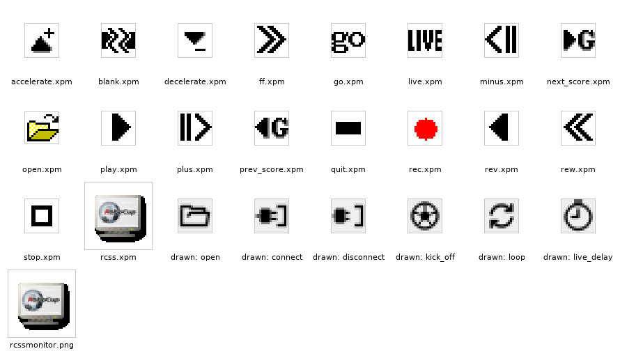
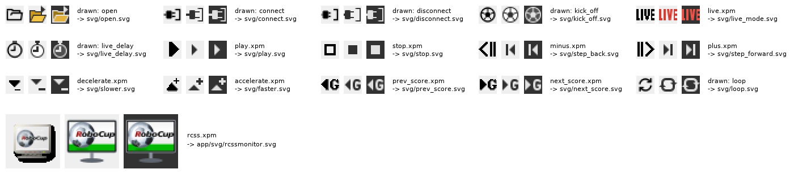

# 古いアイコン

日本語 | [English](README_en.md)

rcssmonitor が 2026年11月まで使っていたアイコンを、記録として残している。
これらは新しいアイコン (`icons/svg/`、`icons/app/`) に置き換えた
(計画書 `docs/plan/2026-11-22-01_icon-redesign.md`)。

このディレクトリのファイルはビルドでは使わず、配布用の tarball にも含めない
(`.gitattributes` の `export-ignore`。autotools の `EXTRA_DIST` にも載せていない)。

## ファイル

| ファイル | 内容 |
|---|---|
| `xpm/` | 古いアイコン (XPM 18 個)。もとは `icons/` にあり、ソースから `#include` して使っていた。ツールバーのものは、パレットの文字色 (`QPalette::ButtonText`) で塗り直して描いていた。置き換えた時点で使われていなかったものも含む |
| `rcssmonitor.png` | 古いアプリのアイコン (48×48)。CMake が hicolor の 48×48 にインストールしていた |
| `rcss.ico` | 古い Windows 用のアイコン (48×48。`src/rcssmonitor.rc` が参照する)。今の `icons/rcss.ico` は新しいアイコンから作った |
| `rcss.icns` | 古い macOS 用のアイコン (16〜512 px)。どのビルドも使っていなかった。新しいアイコンからは作っていない (作るとロゴを拡大することになるため) |
| `old-icons.png` | 古いアイコンの一覧 (16×16 は 3 倍、48×48 は 2 倍)。コードで描いていた 6 個 (`src/toolbar_icons.cpp` の `DrawnIcon`。ソースは消した) も、黒で描いて並べた |
| `comparison.png` | 古いアイコン (明るい配色のツールバーでの見え方) と新しいアイコン (明るい配色、暗い配色) の比較 (2 倍) |

## 古いアイコンと新しいアイコンの対応

| 古いアイコン | 新しいアイコン |
|---|---|
| `live.xpm` | `icons/svg/live_mode.svg` |
| `play.xpm`、`stop.xpm` | `icons/svg/play.svg`、`icons/svg/stop.svg` |
| `minus.xpm`、`plus.xpm` | `icons/svg/step_back.svg`、`icons/svg/step_forward.svg` |
| `decelerate.xpm`、`accelerate.xpm` | `icons/svg/slower.svg`、`icons/svg/faster.svg` |
| `prev_score.xpm`、`next_score.xpm` | `icons/svg/prev_score.svg`、`icons/svg/next_score.svg` |
| コードで描いていた Open、Connect、Disconnect、KickOff、Loop、LiveDelay | `icons/svg/open.svg`、`connect.svg`、`disconnect.svg`、`kick_off.svg`、`loop.svg`、`live_delay.svg` |
| `rcss.xpm` (窓のアイコン)、`rcssmonitor.png` (インストールするアイコン) | `icons/app/svg/rcssmonitor.svg` (RoboCup の公式のロゴを、細い縁のモニタの画面に置いた) |

置き換えた時点で使われていなかったアイコン (8 個): `blank`、`ff`、`go`、`open` (ツールバーはコードで描いた Open を使っていた)、`quit`、`rec`、`rev`、`rew`

## 古いアイコンの一覧

## 古いアイコンと新しいアイコンの比較

各アイコンについて、左から古いアイコン、新しいアイコン (明るい配色)、新しいアイコン (暗い配色)。

