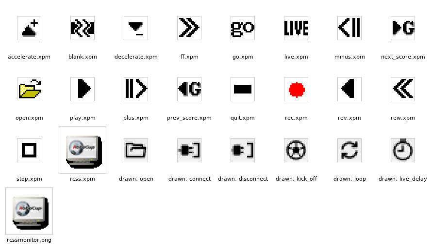
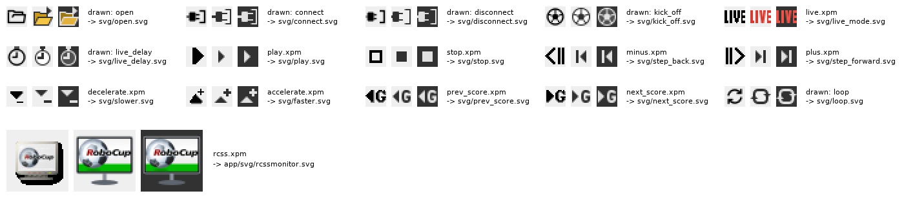

# The old icons

[日本語](README.md) | English

The icons that rcssmonitor used until November 2026 are kept here as a record.
They were replaced by the new icons (`icons/svg/`, `icons/app/`)
(the plan `docs/plan/2026-11-22-01_icon-redesign_en.md`).

The files in this directory are not used by the build and are not in the source tarball
(`export-ignore` in `.gitattributes`; not in `EXTRA_DIST` of autotools either).

## Files

| File | Content |
|---|---|
| `xpm/` | The old icons (18 XPMs). They were in `icons/` and used by `#include` in the sources. The toolbar ones were drawn recolored with the palette's text color (`QPalette::ButtonText`). Including the ones not used at the time of the replacement |
| `rcssmonitor.png` | The old application icon (48×48). CMake installed it as hicolor's 48×48 |
| `rcss.ico` | The old icon for Windows (48×48; `src/rcssmonitor.rc` refers to it). Today's `icons/rcss.ico` was made from the new icon |
| `rcss.icns` | The old icon for macOS (16 to 512 px). No build used it. It was not made from the new icon (that would enlarge the logo) |
| `old-icons.png` | The list of the old icons (16×16 magnified 3 times, 48×48 twice). The 6 icons drawn in code (`DrawnIcon` of `src/toolbar_icons.cpp`; the source was removed) are drawn in black there too |
| `comparison.png` | The old icons (as drawn in the tool bar with the light scheme) and the new ones (light and dark schemes), compared (magnified twice) |

## The old icons and the new ones

| Old icon | New icon |
|---|---|
| `live.xpm` | `icons/svg/live_mode.svg` |
| `play.xpm`, `stop.xpm` | `icons/svg/play.svg`, `icons/svg/stop.svg` |
| `minus.xpm`, `plus.xpm` | `icons/svg/step_back.svg`, `icons/svg/step_forward.svg` |
| `decelerate.xpm`, `accelerate.xpm` | `icons/svg/slower.svg`, `icons/svg/faster.svg` |
| `prev_score.xpm`, `next_score.xpm` | `icons/svg/prev_score.svg`, `icons/svg/next_score.svg` |
| Open, Connect, Disconnect, KickOff, Loop and LiveDelay drawn in code | `icons/svg/open.svg`, `connect.svg`, `disconnect.svg`, `kick_off.svg`, `loop.svg`, `live_delay.svg` |
| `rcss.xpm` (the window icon), `rcssmonitor.png` (the installed icon) | `icons/app/svg/rcssmonitor.svg` (the official RoboCup logo in the screen of a monitor with a thin frame) |

The icons not used at the time of the replacement (8): `blank`, `ff`, `go`, `open` (the tool bar used Open drawn in code), `quit`, `rec`, `rev`, `rew`

## The list of the old icons

## The old icons and the new ones compared

For each icon, from the left: the old icon, the new icon (light scheme), the new icon (dark scheme).

